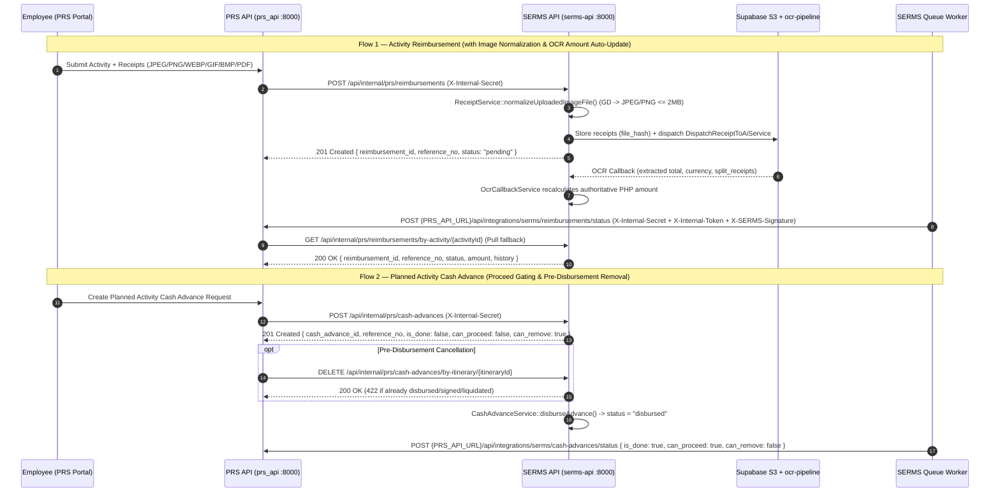

# Productivity Report System (PRS) ↔ SERMS Integration Handoff & Contract Guide

**Project:** Smart Expense & Reimbursement Management System (SERMS) ↔ Productivity Report System (PRS)  
**Client / Partner:** Science Biotech Specialties Inc. (SBSI)  
**Date:** Nov 23, 2026  
**Version:** 1.0.0  
**Status:** Active Handoff Specification  
**Last reconciled:** Nov 23, 2026 (Locked SERMS ↔ PRS Flow 1 & Flow 2 integration contract)  
**Canonical Spec:** [SERMS.md](SERMS.md) · **Related Docs:** [CHANGELOG.md](CHANGELOG.md) · [DOC_CHANGELOG.md](DOC_CHANGELOG.md) · [TS_INTEGRATION_HANDOFF.md](TS_INTEGRATION_HANDOFF.md) · [index.md](index.md)

---

> **What this is:** The authoritative cross-repository integration contract, Flow 1 (Activity Reimbursement) & Flow 2 (Planned Activity Cash Advance) specification, deployment/tunneling runbook, and verification guide connecting **SERMS** (`Scientific-Biotech-Specialties-Inc/smart-expense-management-system`) with **PRS** (`prs_api` / Productivity Report System).

---

## 1. Architecture Overview

SBSI sales and field personnel log client visits, diagnostics, and planned itineraries in **PRS** (`prs_api` + PRS Portal) and synchronize financial workflows with **SERMS** (`serms-api` + `serms-worker`) across two bi-directional flows:

1. **Flow 1 — Activity Reimbursement (`prs_activity_id`):**
   - An employee completes a field/sales activity in PRS and uploads 1–6 receipts (`jpeg, jpg, png, webp, gif, bmp, pdf`) to SERMS (`POST /api/internal/prs/reimbursements`).
   - SERMS normalizes non-JPEG/PNG raster images (`webp`, `gif`, `bmp`, `jfif`) into JPEG/PNG (`<= 2 MB`) via PHP GD (`ReceiptService::normalizeUploadedImageFile()`) before persisting them to Supabase S3 and dispatching async Tesseract OCR + FX conversion.
   - Upon OCR completion (`OcrCallbackService`), SERMS attaches any `split_receipts`, recalculates the authoritative `PHP` claim amount (`reimbursements.amount`) via `CurrencyConversionService::resolveAuthoritativePhpTotal()`, and dispatches `UpdatePrsReimbursementStatusJob` back to PRS. Subsequent accounting transitions (`approve`, `revise`, `reject`, `grant`) also push status webhooks to PRS, while PRS can pull status anytime via `GET /api/internal/prs/reimbursements/by-activity/{activityId}`.
2. **Flow 2 — Planned Activity Cash Advance (`itinerary_id`):**
   - An employee creates a planned activity / itinerary in PRS requesting a cash advance (`POST /api/internal/prs/cash-advances`).
   - SERMS creates a `CashAdvance` (`source_system = 'prs'`, `itinerary_id`, `reference_no = CA-YYYY-00000`) and enforces **proceed gating** (`is_done`, `can_proceed`, `can_remove`):
     - Before disbursement (`pending`, `approved`, `rejected`, `revise`): `is_done: false`, `can_proceed: false`, `can_remove: true`. PRS may cancel/remove the request via `DELETE /api/internal/prs/cash-advances/by-itinerary/{itineraryId}`.
     - Once disbursed (`disbursed`, `signed`, `liquidated`): `is_done: true`, `can_proceed: true`, `can_remove: false`. Pre-disbursement removal is blocked with `422 Unprocessable Entity`, and `UpdatePrsCashAdvanceStatusJob` unlocks the planned activity in PRS.



---

## 2. SERMS ↔ PRS API Contract Reference

### 2.1 Authentication & Required Headers

| Direction | Middleware / Verifier | Headers Sent | Env Secret Source | Failure Status |
|---|---|---|---|---|
| **PRS → SERMS** (`/api/internal/prs/*`) | SERMS `auth.internal` (`AuthenticateInternalService`) | `X-Internal-Secret: <secret>` (or `Authorization: Bearer <secret>` fallback) | Checks `config('services.prs.internal_secret')` first (`PRS_INTERNAL_SECRET ?: INTERNAL_SERVICE_SECRET ?: PRS_REIMBURSEMENT_API_KEY`), with `PRS_INTERNAL_SECRET` and `INTERNAL_SERVICE_SECRET` env fallbacks, via `hash_equals()` | `401 Unauthorized` |
| **SERMS → PRS** (`UpdatePrsReimbursementStatusJob`, `UpdatePrsCashAdvanceStatusJob`) | PRS Integration Auth | `X-Internal-Secret`, `X-Internal-Token`, and `X-SERMS-Signature` (HMAC-SHA256) | `services.prs.internal_secret` and `services.prs.webhook_secret` (`PRS_WEBHOOK_SECRET ?: PRS_INTERNAL_SECRET ?: INTERNAL_SERVICE_SECRET`) | `401 Unauthorized` |

---

### 2.2 Flow 1 — Inbound: Submit Activity Reimbursement (PRS → SERMS)

- **Endpoint:** `POST /api/internal/prs/reimbursements` (via `auth-proxy`: `POST /api/serms/internal/prs/reimbursements`)
- **Middleware:** `auth.internal`
- **Content-Type:** `multipart/form-data`
- **Headers:** `X-Internal-Secret: <INTERNAL_SERVICE_SECRET>` (or `Authorization: Bearer <INTERNAL_SERVICE_SECRET>`), `Accept: application/json`

#### Request Fields

| Field | Accepted Alias | Type | Required | Rules & Notes |
|---|---|---|---|---|
| `activity_id` | `activity_submission_id` | integer | Yes | `>= 1`, stored as `reimbursements.prs_activity_id` |
| `receipts[]` | `files[]`, `attachments[]` | file[] | Yes | `1..6` files; allowed types: `jpeg, jpg, png, webp, gif, bmp, pdf`; max `5 MB` pre-normalization (`<= 2 MB` post-normalization) |
| `employee_email` | `employee[email]` | string (email) | Yes | Resolves or provisions the SERMS `User` record |
| `employee_name` | `employee[name]` | string | Yes | Max `255` chars |
| `employee_id` | `employee[id]` | string / int | No | Optional external employee identifier |
| `department` | `employee[department]` | string | No | Defaults to `'Sales & Marketing'` |
| `institution` | `client_name` | string | No | Institution or client name |
| `activity_type` | `event_type` | string | No | Activity or event classification |
| `activity_date` | `expense_date`, `date` | date | No | ISO `YYYY-MM-DD`; defaults to today |
| `description` | `purpose` | string | No | Claim description / purpose |
| `amount` | — | numeric | No | Optional initial amount; defaults to `0.00` (auto-updated in PHP upon OCR completion) |
| `expense_category` | `expense_category_id` | int or string | No | Optional category ID or name (auto-populated from OCR if null) |

#### Processing, Image Normalization & OCR Amount Auto-Update

1. **Cardinality (1 Active Claim per `prs_activity_id`):**
   - `PrsActivityReimbursementService::importFromRequest()` checks `findLatestByActivityId($activityId)`.
   - If an active non-rejected claim exists (`status !== 'rejected'`), SERMS returns **`200 OK`** (`created: false`) without creating a duplicate.
   - If no claim exists or the prior claim reached terminal **`rejected`**, SERMS creates a new claim (`201 Created`).
2. **Image Normalization (`ReceiptService::normalizeUploadedImageFile()`):**
   - Inside `storeReceiptFiles()`, any non-JPEG/PNG raster image (`WEBP`, `GIF`, `BMP`, `JFIF`) is converted via PHP GD (`imagecreatefromstring` → PNG/JPEG `<= 2 MB`) before uploading to Supabase S3. Native `JPEG`, `PNG`, and `PDF` files are passed through untouched.
3. **Atomic Persistence & OCR Dispatch:**
   - Reuses `ReceiptService::storeAndValidateUploadedFiles()` + `dispatchOcrJob()`, sets `source_system = 'prs'`, `prs_activity_id`, and logs `PRS_REIMBURSEMENT_RECEIVED` via `AuditLogService::log()` inside `DB::transaction()`.
4. **OCR Completion Amount Auto-Update (`OcrCallbackService`):**
   - When OCR finishes (including `split_receipts`), for each linked `Reimbursement` in `['pending', 'submitted', 'processing']`, `OcrCallbackService` attaches any `$splitIds` via `syncWithoutDetaching()`, recalculates the authoritative `PHP` `amount` via `CurrencyConversionService::resolveAuthoritativePhpTotal()` (and sets `expense_category_id` if null), and if `source_system === 'prs'`, dispatches `UpdatePrsReimbursementStatusJob`.

#### Responses

- **`201 Created`:** Returns `{ reimbursement_id, reference_no, status: "pending", prs_activity_id, message, data }`.
- **`200 OK` (Idempotent Retry):** Returns `{ reimbursement_id, reference_no, status, prs_activity_id, message, data }`.
- **`401 Unauthorized` / `422 Unprocessable Entity`:** Invalid secret or validation/duplicate receipt failure.

---

### 2.3 Flow 1 — Inbound: Pull Reimbursement Status (PRS → SERMS)

- **Endpoint:** `GET /api/internal/prs/reimbursements/by-activity/{activityId}`
- **Middleware:** `auth.internal`
- **Headers:** `X-Internal-Secret: <INTERNAL_SERVICE_SECRET>`, `Accept: application/json`
- **Responses:**
  - `200 OK`: `{ reimbursement_id, reference_no, activity_id, prs_activity_id, status, serms_status, is_reimbursed, amount, rejection_comment, approved_at, updated_at, history }`
  - `404 Not Found`: When no reimbursement exists for `activityId`.

---

### 2.4 Flow 1 — Outbound: Reimbursement Status Webhook (SERMS → PRS)

Dispatched by `OcrCallbackService` (on OCR completion when `source_system === 'prs'`) and by `ReimbursementService` (`approveReimbursement`, `rejectReimbursement`, `grantReimbursement` when `source_system === 'prs' || !empty($reimbursement->prs_activity_id)`):

- **Target:** `config('services.prs.reimbursement_status_api_url')` or `rtrim(config('services.prs.api_url'), '/') . '/api/integrations/serms/reimbursements/status'`
- **Headers:** `X-Internal-Secret`, `X-Internal-Token`, `X-SERMS-Signature`, `Content-Type: application/json`
- **Payload (`UpdatePrsReimbursementStatusJob`):**
```json
{
  "external_reference": "RMB-2026-00042",
  "reference_no": "RMB-2026-00042",
  "reimbursement_id": 42,
  "activity_id": 501,
  "source_submission_id": "501",
  "status": "approved",
  "serms_status": "approved",
  "is_reimbursed": false,
  "amount": 1850.00,
  "rejection_comment": null,
  "updated_at": "2026-11-23T11:45:00+00:00"
}
```

---

### 2.5 Flow 2 — Inbound: Create/Get Planned Activity Cash Advance (PRS → SERMS)

- **Endpoint:** `POST /api/internal/prs/cash-advances`
- **Middleware:** `auth.internal`
- **Headers:** `X-Internal-Secret: <INTERNAL_SERVICE_SECRET>`, `Accept: application/json`, `Content-Type: application/json`

#### Request Fields

| Field | Accepted Alias | Type | Required | Rules & Notes |
|---|---|---|---|---|
| `itinerary_id` | `planned_activity_id` | integer | Yes | `>= 1`, stored as `cash_advances.itinerary_id` |
| `amount` | — | numeric | Yes | `>= 0.01` (`PHP`) |
| `employee_email` | `employee[email]` | string (email) | Yes | Resolves or provisions SERMS `User` |
| `employee_name` | `employee[name]` | string | Yes | Max `255` chars |
| `employee_id` | `employee[id]` | string / int | No | Optional external employee identifier |
| `department` | `employee[department]` | string | No | Defaults to `'Sales & Marketing'` |
| `institution` | `client_name` | string | No | Client or institution name |
| `activity_type` | — | string | No | Planned activity type |
| `scheduled_date` | `expected_disbursement_date` | date | No | ISO `YYYY-MM-DD`; defaults to today |
| `expected_liquidation_date` | — | date | No | ISO `YYYY-MM-DD`; defaults to disbursement + 7 days |
| `purpose` | `notes` | string | No | Cash advance purpose / justification |

#### Proceed Gating & Cardinality Rules

- **Cardinality:** 1 active non-rejected `CashAdvance` per `itinerary_id` (`source_system = 'prs'`). Returns `200 OK` (`created: false`) on retry if active; `201 Created` otherwise.
- **Persistence & Audit:** Creates `CashAdvance` (`status = 'pending'`, `reference_no = CA-YYYY-00000`), `CashAdvanceStatusHistory`, notifications, and logs `PRS_CASH_ADVANCE_CREATED` via `AuditLogService::log()` inside `DB::transaction()`.
- **Proceed Gating Flags (`PrsCashAdvanceService::formatGatingPayload()`):**
  - `is_done`: `in_array($status, ['disbursed', 'signed', 'liquidated'], true)`
  - `can_proceed`: equals `is_done` (`true` only after disbursement)
  - `can_remove`: `!is_done` (`true` prior to disbursement; `false` once `disbursed`, `signed`, or `liquidated`)

#### Response (`201 Created` / `200 OK`)

```json
{
  "cash_advance_id": 19,
  "reference_no": "CA-2026-00019",
  "itinerary_id": 88,
  "status": "pending",
  "amount": 5000.00,
  "is_done": false,
  "can_proceed": false,
  "can_remove": true,
  "message": "PRS cash advance request created."
}
```

---

### 2.6 Flow 2 — Inbound: Pull & Pre-Disbursement Removal (PRS → SERMS)

- **Pull Endpoint:** `GET /api/internal/prs/cash-advances/by-itinerary/{itineraryId}`
  - Returns `200 OK` with `CashAdvance` + `formatGatingPayload()` (`is_done`, `can_proceed`, `can_remove`), or `404 Not Found`.
- **Remove Endpoint:** `DELETE /api/internal/prs/cash-advances/by-itinerary/{itineraryId}`
  - Locks the latest `CashAdvance` for `itinerary_id`.
  - Returns `404 Not Found` if none exists.
  - Returns **`422 Unprocessable Entity`** if `status` is in `['disbursed', 'signed', 'liquidated']` (proceed gating locked).
  - Otherwise, inside `DB::transaction()`, logs `PRS_CASH_ADVANCE_REMOVED` via `AuditLogService::log()` and deletes `documents`, `approvalActions`, `statusHistory`, and the `CashAdvance` record (`200 OK`).

---

### 2.7 Flow 2 — Outbound: Cash Advance Status Webhook (SERMS → PRS)

Dispatched by `CashAdvanceService` (`approveAdvance`, `rejectAdvance`, `disburseAdvance`, `acknowledgeAdvance`, `updateAdvance`) and `LiquidationController::audit()` whenever `$advance->source_system === 'prs' || !empty($advance->itinerary_id)`:

- **Target:** `config('services.prs.cash_advance_status_api_url')` or `rtrim(config('services.prs.api_url'), '/') . '/api/integrations/serms/cash-advances/status'`
- **Headers:** `X-Internal-Secret`, `X-Internal-Token`, `X-SERMS-Signature`, `Content-Type: application/json`
- **Payload (`UpdatePrsCashAdvanceStatusJob`):**
```json
{
  "cash_advance_id": 19,
  "external_reference": "CA-2026-00019",
  "reference_no": "CA-2026-00019",
  "itinerary_id": 88,
  "status": "disbursed",
  "amount": 5000.00,
  "is_done": true,
  "can_proceed": true,
  "can_remove": false,
  "rejection_comment": null,
  "updated_at": "2026-11-23T11:50:00+00:00"
}
```

---

## 3. SERMS Frontend UI Integration (`apps/web`)

1. **Reimbursements (`ReimbursementsTable.vue`, `ReimbursementDetailsModal.vue`, `useReimbursementFilters.js`):**
   - Renders `From PRS` and `Activity #<prs_activity_id || source_submission_id>` badges when `row.source_system === 'prs' || row.prs_activity_id`.
   - Includes `prs_activity_id` and `source_submission_id` in table search filtering.
2. **Cash Advances (`CashAdvanceTable.vue`, `CashAdvanceDetailsModal.vue`, `CashAdvancesView.vue`):**
   - Renders `From PRS` and `Planned Activity #<itinerary_id>` badges in the Purpose column and Admin/Employee modal headers when `source_system === 'prs' || itinerary_id`.
   - Includes `itinerary_id` and `source_system` in `searchedRows` search filtering.

---

## 4. Local Port-Forwarding, Cloudflare Tunnel & Azure Container Apps

> [!CAUTION]
> **PRODUCTION SECRET ROTATION WARNING:**  
> Setting `INTERNAL_SERVICE_SECRET=secret` (or `PRS_INTERNAL_SECRET=secret`) is **strictly for local / port-forwarded / tunnel development testing ONLY**. Never use `secret` in staging or production. Before deploying to Azure Container Apps or SBSI servers, rotate `INTERNAL_SERVICE_SECRET`, `PRS_INTERNAL_SECRET`, and `PRS_WEBHOOK_SECRET` to a cryptographically random value of **at least 32 bytes** (e.g. `openssl rand -hex 32`) stored in Azure Container Apps Secrets / `secrets.prod.json`.

### 4.1 Environment Variable Matrix

| Variable | System | Local / Tunnel Example | Production (Azure Container Apps) |
|---|---|---|---|
| `INTERNAL_SERVICE_SECRET` | SERMS & PRS | `secret` *(local test only!)* | `<32+ byte secretRef from internalEncryptionKey>` |
| `PRS_INTERNAL_SECRET` | SERMS | *(optional; falls back to `INTERNAL_SERVICE_SECRET`)* | Set if PRS rotates its S2S secret independently |
| `PRS_WEBHOOK_SECRET` | SERMS | *(optional; falls back to `PRS_INTERNAL_SECRET` / `INTERNAL_SERVICE_SECRET`)* | `<32+ byte HMAC signing secret>` |
| `PRS_API_URL` | SERMS | `https://<prs-tunnel>.trycloudflare.com` or `http://host.docker.internal:8001` | `http://prs-api` (same ACA env) or `https://<prs-api-fqdn>` |
| `PRS_PORTAL_URL` | SERMS | `https://<prs-portal>.trycloudflare.com` | `https://<prs-portal-fqdn>` |
| `PRS_REIMBURSEMENT_STATUS_API_URL` | SERMS | *(optional override for `{PRS_API_URL}/api/integrations/serms/reimbursements/status`)* | *(optional override)* |
| `PRS_CASH_ADVANCE_STATUS_API_URL` | SERMS | *(optional override for `{PRS_API_URL}/api/integrations/serms/cash-advances/status`)* | *(optional override)* |
| `PRS_REIMBURSEMENT_STATUS_API_TIMEOUT` | SERMS | `10` | `10` |
| `SERMS_API_URL` | PRS | `https://<serms-tunnel>.trycloudflare.com` or `http://host.docker.internal:8000` | `http://serms-api` (same ACA env) or `https://<serms-api-fqdn>` |

### 4.2 Local Port-Forwarding & Cloudflare Tunnel Setup

1. **SERMS Host (`apps/api/.env` + `docker-compose.yml`):**
   ```dotenv
   INTERNAL_SERVICE_SECRET=secret
   PRS_API_URL=https://<prs-tunnel>.trycloudflare.com
   PRS_REIMBURSEMENT_STATUS_API_TIMEOUT=10
   ```
   - Recreate `php` and `api_queue` (`docker compose up -d php api_queue`) and run `docker compose exec php php artisan migrate`.
   - Inside Docker containers, use `host.docker.internal:<port>` (port-forwarding) or an HTTPS Cloudflare tunnel (`cloudflared tunnel --url http://localhost:8000`) instead of `localhost`.
2. **PRS Host (`prs_api/.env`):**
   ```dotenv
   INTERNAL_SERVICE_SECRET=secret
   SERMS_API_URL=https://<serms-tunnel>.trycloudflare.com
   ```

### 4.3 Azure Container Apps (`capstone-azure-infra`)

- Ensure `serms.bicep` injects `INTERNAL_SERVICE_SECRET`, `PRS_API_URL`, `PRS_PORTAL_URL`, `PRS_INTERNAL_SECRET`, `PRS_WEBHOOK_SECRET`, `PRS_REIMBURSEMENT_STATUS_API_URL`, `PRS_CASH_ADVANCE_STATUS_API_URL`, and `PRS_REIMBURSEMENT_STATUS_API_TIMEOUT=10` on **both** `serms-api` and `serms-worker` (required for `UpdatePrsReimbursementStatusJob` and `UpdatePrsCashAdvanceStatusJob`).
- Ensure `prs` container app receives `SERMS_API_URL` and the shared `INTERNAL_SERVICE_SECRET` secretRef.

---

## 5. End-to-End `curl` Verification Commands

```bash
SERMS_BASE="http://localhost:8000"
SECRET="secret"
```

1. **Flow 1 — Verify `401 Unauthorized` on invalid `X-Internal-Secret`:**
   ```bash
   curl -i -X POST "$SERMS_BASE/api/internal/prs/reimbursements" \
     -H "X-Internal-Secret: wrong-secret" \
     -H "Accept: application/json"
   ```

2. **Flow 1 — Submit Activity Reimbursement (`201 Created`, supports WEBP/GIF/BMP normalization):**
   ```bash
   curl -i -X POST "$SERMS_BASE/api/internal/prs/reimbursements" \
     -H "X-Internal-Secret: $SECRET" \
     -H "Accept: application/json" \
     -F "activity_id=501" \
     -F "employee_email=employee@example.com" \
     -F "employee_name=Juan Dela Cruz" \
     -F "department=Sales & Marketing" \
     -F "institution=St. Luke's Medical Center" \
     -F "activity_type=Client Visit" \
     -F "activity_date=2026-11-23" \
     -F "description=Diagnostic kit presentation meals and parking" \
     -F "receipts[]=@docs/receipts/receipt 1.jpg"
   ```

3. **Flow 1 — Pull Reimbursement Status by Activity ID (`200 OK`):**
   ```bash
   curl -i "$SERMS_BASE/api/internal/prs/reimbursements/by-activity/501" \
     -H "X-Internal-Secret: $SECRET" \
     -H "Accept: application/json"
   ```

4. **Flow 2 — Create Planned Activity Cash Advance (`201 Created`, `is_done: false`, `can_proceed: false`, `can_remove: true`):**
   ```bash
   curl -i -X POST "$SERMS_BASE/api/internal/prs/cash-advances" \
     -H "X-Internal-Secret: $SECRET" \
     -H "Content-Type: application/json" \
     -H "Accept: application/json" \
     -d '{
       "itinerary_id": 88,
       "amount": 5000.00,
       "employee_email": "employee@example.com",
       "employee_name": "Juan Dela Cruz",
       "department": "Sales & Marketing",
       "institution": "Makati Medical Center",
       "activity_type": "Regional Demo",
       "scheduled_date": "2026-11-25",
       "purpose": "Regional diagnostic demo travel advance"
     }'
   ```

5. **Flow 2 — Pull Cash Advance Status & Remove Before Disbursement (`200 OK`; `422` if disbursed):**
   ```bash
   curl -i "$SERMS_BASE/api/internal/prs/cash-advances/by-itinerary/88" \
     -H "X-Internal-Secret: $SECRET" \
     -H "Accept: application/json"

   curl -i -X DELETE "$SERMS_BASE/api/internal/prs/cash-advances/by-itinerary/88" \
     -H "X-Internal-Secret: $SECRET" \
     -H "Accept: application/json"
   ```
