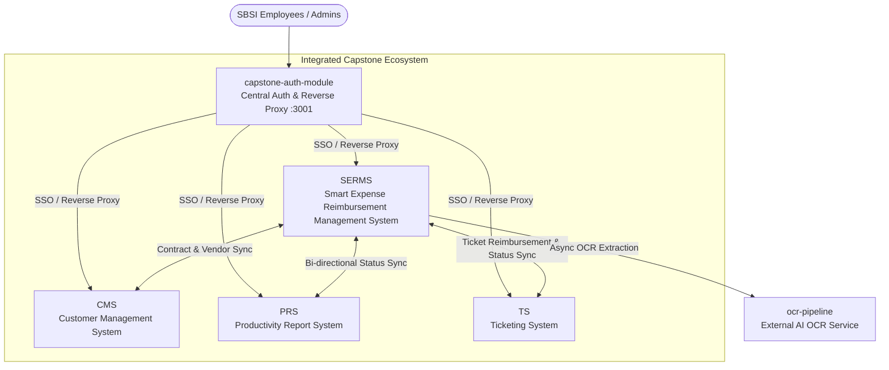
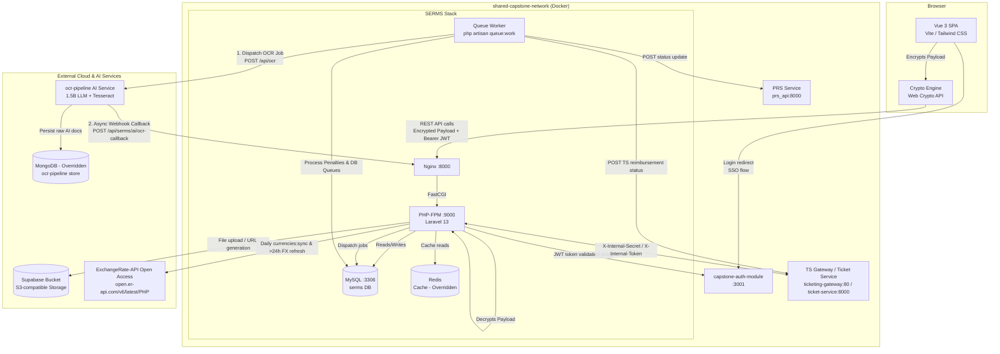
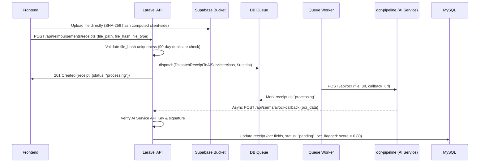

# SERMS Master Specification (Canonical Single Source of Truth)

**Project:** Smart Expense & Reimbursement Management System (SERMS)  
**Client / Partner:** Science Biotech Specialties Inc. (SBSI) — [https://sbsi.com.ph/about-us/](https://sbsi.com.ph/about-us/)  
**Academic Context:** 3rd & 4th Year Capstone Project (Capstone 1: Completed July 2026 · Capstone 2: September–December 2026)  
**Date:** 2026-09-01  
**Version:** 1.5.1  
**Owner:** SERMS Engineering & Architecture Council (Capstone Team)  
**Status:** Canonical Source of Truth  
**Last reconciled:** 2026-09-01 (Documentation suite refactor & standardization of 'What this is' sections across all docs)  
**Canonical Spec:** [SERMS.md](SERMS.md) · **Related Docs:** [index.md](index.md) · [PRD.md](PRD.md) · [SAD.md](SAD.md) · [SDD.md](SDD.md) · [DSD.md](DSD.md) · [Build.md](Build.md) · [OPS.md](OPS.md) · [QAD.md](QAD.md) · [CHANGELOG.md](CHANGELOG.md) · [TS_INTEGRATION_HANDOFF.md](TS_INTEGRATION_HANDOFF.md) · [AGENTS.md](../AGENTS.md)

---

> **What this is:** The canonical, authoritative Master Single Source of Truth for the Smart Expense & Reimbursement Management System (SERMS). It unifies product requirements (PRD), software architecture (SAD), modular system design and crypto protocols (SDD), clinical design system (DSD), build operations and agent guardrails (Build/AGENTS), cloud infrastructure (OPS), QA testing datasets (QAD), and historical context (CHANGELOG) into a single overarching reference. All other documentation files and code implementations derive from and must align with this document.

---

> [!IMPORTANT]
> **CANONICAL GOVERNANCE DIRECTIVE:**  
> This file (`docs/SERMS.md`) is the **primary, authoritative single source of truth** for the entire SERMS ecosystem. All human developers, AI agents, subagents, and downstream documentation guides (`PRD.md`, `SAD.md`, `SDD.md`, `DSD.md`, `Build.md`, `OPS.md`, `QAD.md`, `index.md`, and `AGENTS.md`) **MUST cross-reference this file first** before initiating any design, implementation, refactoring, or testing task. If any modification, architectural change, or requirement evolution is required, **this file must be updated first** before applying changes elsewhere.

---

## Table of Contents

1. [Document Read Order & Governance](#1-document-read-order--governance)
2. [Project & Client Background (SBSI & Capstone Ecosystem)](#2-project--client-background-sbsi--capstone-ecosystem)
3. [Client Server Constraints, AI Limits & Tech Decisions](#3-client-server-constraints-ai-limits--tech-decisions)
4. [Product Vision, Business Rules & Compliance (PRD)](#4-product-vision-business-rules--compliance-prd)
5. [Software Architecture & System Topology (SAD)](#5-software-architecture--system-topology-sad)
6. [System Design, Modules & Cryptography (SDD)](#6-system-design-modules--cryptography-sdd)
7. [Design System & Frontend UX Standards (DSD)](#7-design-system--frontend-ux-standards-dsd)
8. [Development, Build & Guardrail Conventions (Build & AGENTS)](#8-development-build--guardrail-conventions-build--agents)
9. [Operations, Reliability, Cloud & Azure Infra (OPS)](#9-operations-reliability-cloud--azure-infra-ops)
10. [Quality Assurance & Receipt Testing Guide (QAD)](#10-quality-assurance--receipt-testing-guide-qad)
11. [Changelog & Historical Context (CHANGELOG)](#11-changelog--historical-context-changelog)

---

## 1. Document Read Order & Governance

Every session, developer, and AI agent must ingest documentation in this exact sequence:

1. **`docs/SERMS.md`** *(This file — The Canonical Master Source of Truth)*
2. **`docs/CHANGELOG.md`** *(Historical context, ADRs, and change evolutions)*
3. **`docs/PRD.md`** *(Product requirements, workflows, and business compliance rules)*
4. **`docs/SAD.md`** *(Software architecture and modular monolith layering)*
5. **`docs/SDD.md`** *(System design, database ER diagram, crypto, and OCR pipeline)*
6. **`docs/DSD.md`** *(Design system, typography, 22-status badge map, and border rules)*
7. **`docs/OPS.md`** *(Operations runbook, Azure student budget, SLOs, and incident response)*
8. **`docs/QAD.md`** *(QA test plan, sample receipt datasets, and validation gates)*
9. **`docs/Build.md`** *(Build setup, golden path implementation patterns, and development guardrails)*
10. **`AGENTS.md`** *(Materialized developer & agent operational guide)*

---

## 2. Project & Client Background (SBSI & Capstone Ecosystem)

### 2.1 The Client: Science Biotech Specialties Inc. (SBSI)
- **Company Profile:** Science Biotech Specialties Inc. (SBSI) is a prominent healthcare and biotechnology solutions provider in the Philippines, delivering clinical laboratory diagnostics, medical devices, reagents, and technical field services.
- **Official Website:** [https://sbsi.com.ph/about-us/](https://sbsi.com.ph/about-us/)
- **Operational Need:** SBSI field engineers, sales representatives, and laboratory technicians regularly incur field travel and emergency procurement expenses. Manual paper-and-spreadsheet expense workflows create delays, tax non-compliance risks under Philippine Bureau of Internal Revenue (BIR) regulations, and untracked cash advance liquidations.

### 2.2 Academic Context & Turnover Mandate
- **Capstone Curriculum:** SERMS is developed as a core requirement for 3rd and 4th-year Computer Science / IT Capstone. The project requires partnering with a real-world enterprise client (SBSI), developing an integrated multi-system suite, deploying it to production infrastructure, and formally turning over the completed system to SBSI.
- **Timeline & Milestones:**
  - **Capstone 1 (Concluded July 2026):** Domain modeling, core modular monolith architecture, initial UI design, prototype OCR integration, and academic defense.
  - **Capstone 2 (September – December 2026):** Full multi-system ecosystem integration, deployment to Azure via `capstone-azure-infra`, user acceptance testing (UAT) with SBSI stakeholders, compliance verification, and final client turnover.

### 2.3 The Multi-System Capstone Ecosystem
SERMS operates as one of four integrated enterprise sub-systems designed for SBSI:

1. **CMS (Customer Management System):** Manages SBSI healthcare accounts, hospital/laboratory client profiles, contact points, and customer engagement histories.
2. **SERMS (Smart Expense Reimbursement Management System — This Project):** Automates reimbursement submissions, cash advance disbursements, OCR receipt parsing, BIR VAT classifications, advance liquidations, and overdue penalty assessments.
3. **PRS (Productivity Report System):** Tracks employee daily deliverables, field diagnostic schedules, and synchronizes reimbursement statuses for project cost accounting.
4. **TS (Ticketing System):** Manages customer service tickets, clinical diagnostic equipment maintenance requests, and technical escalation pipelines, forwarding field engineer ticket reimbursements into SERMS and synchronizing ticket/reimbursement statuses bi-directionally.
5. **Central Access Gateway (`capstone-auth-module`):** All sub-systems (CMS, SERMS, PRS, TS) can **only** be accessed through `capstone-auth-module`. It provides unified SSO, JWT token issuance, session validation, and reverse proxy routing.

---

## 3. Client Server Constraints, AI Limits & Tech Decisions

### 3.1 Client Server Permissions & Resource Constraints
SBSI granted permission for their on-premises / dedicated server to be used for hosting, with strict resource and architecture constraints:

| Constraint / Area | Client Specification / Permission | Status / SERMS Resolution |
|---|---|---|
| **AI Model Ceiling** | **Max 1.5B Parameters:** SBSI strictly capped local/embedded LLM execution to lightweight models (<= 1.5B parameters) to prevent GPU/CPU starvation on shared hardware. | **Enforced:** SERMS OCR extraction prompts and categorization models in `ocr-pipeline` strictly utilize lightweight <= 1.5B parameter models (e.g. Qwen 2.5 1.5B / SmolLM) paired with Tesseract OCR. |
| **Relational Database** | **MySQL Recommended:** SBSI recommended MySQL to match their existing internal systems. | **Approved / Aligned:** Core SERMS transactional database runs on MySQL 8.0 with pre-aggregated SQL queries. |
| **Frontend Framework** | **Vue Recommended:** SBSI standardizes internal frontend systems on Vue. | **Approved / Aligned:** SERMS client is built in Vue 3 (Composition API) with Pinia and Tailwind CSS. |
| **In-Memory Cache (Redis)** | **No Permission Granted:** SBSI did not grant official server permission for Redis. | **Overridden:** Containerized Redis is utilized in Docker for caching and queue acceleration. For strict client compliance upon turnover, SERMS maintains a transparent fallback to Laravel's MySQL Database cache/queue driver (`CACHE_STORE=database`, `QUEUE_CONNECTION=database`). |
| **NoSQL Database (MongoDB)** | **No Permission Granted:** SBSI did not grant official server permission for MongoDB. | **Overridden:** Utilized externally in the standalone `ocr-pipeline` AI service project for storing flexible JSON document schemas, raw OCR bounding boxes, and AI extraction logs. Core SERMS contains zero direct MongoDB dependencies. |

---

## 4. Product Vision, Business Rules & Compliance (PRD)

### 4.1 BIR VAT Rules & Financial Compliance
- **BIR VAT Validation:** Receipts must be strictly classified as **VAT** or **NON-VAT** based on Bureau of Internal Revenue (BIR) validation logic, never on unverified user input.
- **Immutable Auditing:** Append-only audit logs must be recorded for every financial mutation and retained for a minimum of 10 years. Updates and deletes on `audit_logs` and `penalties` tables are strictly forbidden.
- **Session Policies:** Standard user sessions timeout after 90 minutes; Admin/IT sessions timeout after 60 minutes. Concurrent sessions from distinct IP addresses are blocked.
- **No Hallucinations / No Fabrications:** Financial amounts, approval states, penalty calculations, and OCR outputs must never be guessed or fabricated. Missing fields require explicit clarification.

### 4.2 Functional Domain Workflows
- **Expense Reimbursement Submission:** User uploads receipts (JPEG, PNG, PDF <= 2MB). Files are uploaded to Supabase Bucket -> OCR Queue Job dispatches -> external AI processes receipt -> BIR VAT classification, 90-day duplicate check, and system-locked multi-currency FX snapshot conversion to `PHP` run -> user confirms and submits the reimbursement request (with `reimbursements.amount` computed authoritatively in `PHP`).
- **Multi-Receipt Auto-Split & Isolation:** Across all Multi Receipt upload entry points (Reimbursements, My Expense, and Liquidations, up to 6 files), `ocr-pipeline` automatically determines whether the uploaded files represent 1 long multi-segment receipt or multiple distinct receipts (including mixed batches). Single-receipt multi-segment uploads continue rendering as 1 stacked card (`StackedReceiptDeck`) when `split_receipts` is absent. When `split_receipts` is returned during OCR polling, SERMS expands the placeholder into separate individual receipt cards, surfaces an info toast (`Detected N separate receipts — split into individual receipt cards.`), assigns each card only its own `segment_indices` image(s) (preserving single-image vs multi-segment preview behavior), and isolates quality/duplicate/OCR rejections per card without discarding valid sibling cards. Selecting 1 file in Multi Receipt mode falls back cleanly to standard single-receipt upload.
- **Multi-Currency Receipt FX Conversion to PHP:** Foreign-currency receipts preserve their original ISO 4217 `currency` (`char(3)`, defaulting to `PHP`) and `total_amount` on `receipts`, while SERMS resolves and system-locks the conversion snapshot (`exchange_rate`, `converted_php_amount`, `exchange_rate_date`, `exchange_rate_source`) against `currency_rates`. Employees cannot edit or override exchange rates. Live FX rates are synchronized daily via the `currencies:sync` Laravel Scheduler job from ExchangeRate-API Open Access (`https://open.er-api.com/v6/latest/PHP`); when a cached rate is missing or `>24h` old, SERMS performs an on-demand refresh with graceful fallback to the latest cached rate if the external API is unreachable, returning `422` only for unrecognized currency codes. UI receipt modals/cards display a read-only PHP conversion caption while keeping Reimbursement (`reimbursements.amount`) and Liquidation (`liquidations.total_expense_amount`) summary totals strictly in `PHP`.
- **Cash Advance & Routing:** Employee submits purpose, amount, expected disbursement, and liquidation dates -> request routes through active `approval_thresholds` -> Finance/Admin disburses funds via the shared `GrantPayoutModal` (recording `granted_by`, `payout_method` [`Cash`, `E-wallet`, `Card`, `Visa`, `Other`], optional `payout_method_other`, `granter_signature`, auto-generated `CA-{id}-{YmdHis}` reference fallback, and password re-verification, while preserving legacy `{ channel, reference, password }` support) -> employee acknowledges receipt via signature in Cash Advances or the unified Payout module (`PayoutView.vue`, supporting both `Reimbursement` and `Cash Advance` payout types) -> status transitions to `signed` / `unliquidated`.
- **Advance Liquidation & Variance:** Employee submits liquidation report with matching receipts whose server-computed PHP `total_expense_amount` (summed from attached receipts' `converted_php_amount`) is equal to or greater than the cash advance's current `outstanding_balance` (including accrued overdue penalties). Submissions or updates with `total_expense_amount < outstanding_balance` are strictly blocked at both the UI and API (`422` validation error) layers; excess expenses beyond the balance are tracked as overpayment for reimbursement forwarding -> accounting audits and approves -> status marked `liquidated`.
- **Daily Overdue Penalties:** Nightly queued job scans unliquidated cash advances past their 7-day grace period -> applies configured daily penalty (PHP 50.00/day) -> writes immutable penalty records.
- **90-Day Duplicate Detection:** Receipts matching Vendor, Date, Total Amount, or Invoice Number within 90 days are flagged. Submitting an override requires a minimum 20-character justification and generates a dedicated audit log.

---

## 5. Software Architecture & System Topology (SAD)

SERMS follows a **Modular Monolith** architecture deployed within a containerized Docker network and integrated with cloud services.

---

## 6. System Design, Modules & Cryptography (SDD)

### 6.1 Module Roster (Canonical 9 Modules)

| Module | Route Prefix / Namespace | Key Controllers & Services | Key Jobs & Workers | Responsibility |
|---|---|---|---|---|
| **`CashAdvances`** | `/api/cash-advances` `App\Modules\CashAdvances` | `CashAdvanceController` `CashAdvanceService` | `CalculateOverdueCashAdvancesJob` | Lifecycle of cash advances: request, threshold verification, manager approval, Grant Payout disbursement logging (`granted_by`, `payout_method`, `granter_signature`), unified `payout` hydration via `CashAdvanceEnrichmentService`, and employee acknowledgment. |
| **`Reimbursements`** | `/api/reimbursements` `App\Modules\Reimbursements` | `ReimbursementController` `ReceiptController` `ExpenseCategoryController` `PrsReimbursementRequestController` `PrsWebhookController` `OcrCallbackController` `ReimbursementService` `ReceiptService` `TsReimbursementImportService` | `UpdatePrsReimbursementStatusJob` `UpdateTsReimbursementStatusJob` `DispatchReceiptToAiService` | Reimbursement claim submission, multi-receipt uploading & OCR dispatch, 90-day duplicate checking, BIR VAT classification, system-locked multi-currency receipt FX snapshot persistence (`converted_php_amount`) and PHP-authoritative claim totals (`reimbursements.amount`), PRS status sync (`source_system === 'prs'` guarded), TS ticket reimbursement ingestion (`ticket_id`, `ticket_number`, `reference_no`), TS status sync, and approval workflows. |
| **`Expenses`** | `/api/expenses` `App\Modules\Expenses` | `ExpenseController` `ExpenseService` | — | Generic expense logging, line-item recording, receipt linkage, and expense category association. |
| **`Liquidations`** | `/api/liquidations` `App\Modules\Liquidations` | `LiquidationController` | `CalculateDailyPenaltiesJob` | Cash advance liquidation reports, receipt item matching & scanning, PHP-normalized `total_expense_amount` aggregation from attached receipts' `converted_php_amount`, variance/shortfall computation, accounting audit verification, and daily penalty accruals. |
| **`AuditLogs`** | `App\Modules\AuditLogs` | `AuditLogService` | — | Centralized append-only audit trail logging (`AuditLogService::log()`) and compliance export action tracking. |
| **`Notifications`** | `App\Modules\Notifications` | `NotificationDeliveryService` | — | Template-based in-app notification dispatching, failed attempt logging, and role-based hierarchy resolution. |
| **`Ai`** | `App\Modules\Ai` | `AiServiceOcrEngine` `TesseractOcrEngine` | — | OCR contract bindings (`OcrEngineInterface`, `AsyncOcrEngineInterface`), external OCR service communication, payload signing, and webhook validation. |
| **`Users`** | `/api/profile` `App\Modules\Users` | `ProfileController` `ProfileService` `User` Model & Providers | — | User identity mapping, profile management (personal/contact details Dual-Sync with `capstone-auth-module`), Supabase avatar and hybrid signature storage, client-encrypted password updates, and user-scoped audit activity logs. |
| **`Shared`** | `/api/crypto` `/api/auth` `/api/internal` `/api/cms` `/api/ts` `App\Modules\Shared` | `CryptoController` `AuthController` `InternalCmsController` `InternalTsController` `CmsController` `TsController` `PayloadDecryptionService` `PasswordVerificationService` `CmsClientService` `CmsContractExpenseService` `CmsVendorVerificationService` `CmsRecurringExpenseService` `TsClientService` | `currencies:sync` (Daily Scheduler) | Cryptographic public key distribution (`GET /api/crypto/key`), client payload pre-encryption decryption middleware (`DecryptPayloadMiddleware`), external auth SSO proxying (`/api/auth/me`), password re-verification, internal service-to-service endpoints (`X-Internal-Secret`), CMS / TS bi-directional integration proxies/sync, and centralized multi-currency FX rate caching (`currency_rates`) & PHP conversion. |

### 6.2 Client-Side Pre-Encryption Architecture
To prevent shoulder theft, network snooping, and plaintext leakage of sensitive PII/financial mutations:
1. **Key Fetching:** Frontend fetches the RSA-OAEP public key from `GET /api/crypto/key`.
2. **Hybrid Encryption:** Client generates an ephemeral AES-256-GCM symmetric key, encrypts form inputs, and wraps the AES key with the RSA public key (`encrypted_payload` + `encrypted_key` + `iv`).
3. **Server-Side Decryption Middleware:** `DecryptPayloadMiddleware` intercepts incoming requests, decrypts payload fields transparently before reaching Form Requests, and binds plaintext data to `$request`.

### 6.3 Asynchronous OCR Pipeline Flow

#### Smart Multi-Receipt Split Contract
- **Callback & Child Persistence:** For multi-file batches containing multiple receipts, `ocr-pipeline` sends Group 0 (`segment_indices`) as the primary callback payload and Groups `1..G-1` in `split_receipts`. SERMS `OcrCallbackController` creates child `Receipt` rows (inheriting `uploaded_by` and `is_draft`, logging `RECEIPT_CREATED` + OCR outcomes in `AuditLogService`), checks duplicates per sliced `file_hash`, caches the parent-to-child mapping (`receipt_split_children:{id}`), and returns `split_receipt_ids` in the callback response.
- **Polling & Frontend Card Expansion:** `GET /api/serms/reimbursements/receipts/{id}` and `GET /api/serms/liquidations/receipts/{id}` attach `segment_indices` and `split_receipts`. Both `useReceiptUploads.js` (Reimbursements / My Expense) and `FileUpload.vue` (Liquidations) check `split_receipts` before early-returning on `rejected`/`failed`, partition local images/previews by `segment_indices` (falling back sequentially by `file_path` / `file_url` length), expand cards in-place, and evaluate rejections/duplicates per split card independently.

### 6.4 Request Audit Trail & Lifecycle Hydration Architecture
To ensure financial compliance, auditability, and transparent lifecycle tracking across Reimbursements, Cash Advances, and Liquidations:
1. **Zero-Overhead Batch Hydration:** Endpoints (`GET /api/reimbursements`, `GET /api/reimbursements/{id}`, `GET /api/cash-advances`, `GET /api/cash-advances/{id}`, `GET /api/liquidations`, `GET /api/liquidations/{id}`) batch-enrich models with an `audit_trail` array via `AuditLogService` (`enrichReimbursements`, `enrichCashAdvances`, `enrichLiquidations`), avoiding additional HTTP round-trips upon opening modals.
2. **Dual-Source Chronological Synthesis:** Merges canonical immutable records from `audit_logs` with baseline lifecycle event timestamps and workflow action tables (`approvalActions`, `disbursements`, `penalties`), guaranteeing an unbroken chronological timeline for both legacy records and new submissions. `CASH_ADVANCE_DISBURSED` logs `payout_method`, `payout_method_other`, `granted_by`, `channel`, and `reference` inside the atomic disbursement transaction.
3. **Role-Scoped Privacy Masking:** Client IP addresses (`ip_address`) recorded in `audit_logs` are exposed strictly to authorized Administrators (e.g. accounting department with `serms.reimbursements.manage`). Standard employee accounts receive `ip_address: null` at the service layer prior to JSON transmission.
4. **Field-Level Diff Sanitization:** Attribute diffs (`before_state` vs `after_state`) are cleaned using `computeSanitizedDiff()`, excluding internal metadata (`id`, `created_at`, `updated_at`, `password`, `token`) and formatting monetary values into standard currency strings.
5. **Universal View Modal Integration:** The reusable `<BaseAuditTrail />` component (`apps/web/src/components/base/BaseAuditTrail.vue`) is integrated across all 5 request and settlement modals (`ReimbursementDetailsModal.vue`, `PayoutDetailsModal.vue`, `CashAdvanceDetailsModal.vue`, `LiquidationReviewModal.vue`, `LiquidationSettlementForm.vue`). It renders a single unified card formatted as a clean, corporate table (`Time`, `User`, `Action`) with sort toggles (Latest / Oldest First), collapsible headers with badge counts, actor role indicators, Medium Date Format timestamps (`MMM D, YYYY · h:mm A`), inline comments, field change diffs, and a 4-event display cap with expand/collapse.
6. **Multi-Format Export Engine:** Integrated client-side export utility (`apps/web/src/utils/auditTrailExport.js`) supporting instant downloads of the complete audit log in `XLSX` (Excel XML Spreadsheet), `CSV` (RFC-4180 with UTF-8 BOM), `PDF` (pure PDF 1.4 corporate report), and `JSON` directly from the `<BaseAuditTrail />` header.

### 6.5 CMS ↔ SERMS Bi-Directional Integration Architecture
To connect SERMS expenses, vendor compliance, and recurring vendor spend with the Contract Management System (CMS):
1. **Service-to-Service Auth (`auth.internal`):** `AuthenticateInternalService` verifies `X-Internal-Secret` using constant-time `hash_equals()` on all `/api/internal/*` routes, returning `401 Unauthorized` when missing, empty, or invalid.
2. **Inbound CMS Analytics & Vendor History Endpoints:**
   - `GET /api/internal/expenses/by-contract` aggregates `approved` + `granted` reimbursements grouped by `contract_id` with SQL-aggregated `travel`, `spare_parts`, `field_service`, and `other` breakdowns.
   - `GET /api/internal/reimbursements/by-vendor` matches normalized vendor TIN digits first, falls back to case-insensitive `vendor_name`, returns `422` when both are empty, and returns Title Case statuses ordered newest-first.
3. **Outbound CMS Client (`CmsClientService`) & Proxies (`CmsController`):**
   - `GET /api/cms/contracts/active` proxies `GET {CMS_CONTRACT_URL}/active` with graceful offline fallback so `<CmsContractSelect>` lets employees link optional `contract_id` + `client_name` on Reimbursements and Cash Advances.
   - `OcrCallbackService::handle()` and `ReceiptService` invoke `CmsVendorVerificationService::verifyAndTagReceipt()` against `GET {CMS_VENDOR_URL}/internal/vendors/lookup`, tagging `[Accredited Vendor]` (with default expense category pre-fill), `[Unverified Vendor — Secondary Accounting Audit Required]`, or failing safely (`[CMS Lookup Unavailable — Manual Verification Required]`) when CMS is offline. `Reimbursement` claims dynamically compute `fast_track_eligible`, `vendor_audit_required`, and `unverified_vendors`, prioritizing clean accredited claims in the approval queue and requiring explicit `secondary_audit_confirmed` (+ optional `secondary_audit_note`, persisted in `secondary_audit_*` columns and `CLAIM_APPROVED` audit logs) before unverified/flagged claims can be approved.
   - Accounting-scoped `POST /api/cms/vendors/suggest` (`201`/`200`/`409` handling) and `GET /api/cms/recurring-expenses` + `POST /api/cms/contract-requests` (`CmsRecurringExpenseService` detecting `>= 3` claims per vendor in 12 months and persisting `cms_contract_requests` + audit logs).

### 6.6 TS ↔ SERMS Bi-Directional Integration Architecture
To integrate field service ticket reimbursements and ticket lifecycle lookups between the Ticketing System (TS) and SERMS (see full handoff spec in [TS_INTEGRATION_HANDOFF.md](TS_INTEGRATION_HANDOFF.md)):
1. **Service-to-Service Auth (`auth.internal` & Dual Headers):**
   - Inbound TS -> SERMS routes (`/api/internal/ts/*`) enforce `AuthenticateInternalService` (`X-Internal-Secret` validated via `hash_equals()`, checking `config('services.ts.internal_secret')` first then `config('services.cms.internal_secret')`, with `TS_INTERNAL_SECRET` / `INTERNAL_SERVICE_SECRET` env fallbacks; returning `401 Unauthorized` on missing or invalid headers). `EnsureIdempotency` also safely hashes `UploadedFile` metadata and scopes unauthenticated (`user_id = null`) idempotency keys for multipart S2S calls.
   - Outbound SERMS -> TS requests (`TsClientService` and `UpdateTsReimbursementStatusJob`) transmit **both** `X-Internal-Token` and `X-Internal-Secret` populated from `config('services.ts.internal_secret')` (`TS_INTERNAL_SECRET ?: INTERNAL_SERVICE_SECRET`), matching TS `ticket-service` (`VerifyInternalToken`) and `capstone-azure-infra/infra/modules/ticketing.bicep` (which provisions both `INTERNAL_TOKEN` and `INTERNAL_SERVICE_SECRET`).
2. **Inbound Ticket Reimbursement Submission (`POST /api/internal/ts/reimbursements`):**
   - Accepts `multipart/form-data` containing `ticket_id`, `ticket_number`, `employee_email` (or `employee[email]`), `employee_name` (or `employee[name]`), optional `employee_id`/`department`, `amount`, `expense_category` (ID or name) / `expense_category_id`, `description` (or `purpose`, max `255` chars), `expense_date` (or `date`), and `receipts[]` (or `attachments[]`: 1+ JPEG/JPG/PNG/PDF files, max 2MB each).
   - Reuses `ReceiptService` (`storeAndValidateUploadedFiles()`, `cleanupStoredFiles()`, `dispatchOcrJob()`) for Supabase S3 storage, SHA-256 `file_hash`, 90-day duplicate check, and asynchronous `DispatchReceiptToAiService` OCR queue dispatch (with Supabase cleanup if validation or transaction fails).
   - Persists `Receipt` (`is_draft: false`, `status: 'processing'`) and `Reimbursement` in `pending` status (`source_system: 'ts'`, `source_submission_id: (string) $ticketId`, `ticket_id`, `ticket_number`, `is_request: true`, computed `reference_no: 'RMB-YYYY-00000'`), dispatches user/admin notifications, and logs `TS_REIMBURSEMENT_RECEIVED` via `AuditLogService::log()` inside the same `DB::transaction()`.
   - **Cardinality & Idempotency Rule:** Enforces **1 active reimbursement per `ticket_id`**. Retries while a non-rejected reimbursement exists for `ticket_id` return `200 OK` with `{ reimbursement_id, reference_no, status, message, data }`. Migration `2026_11_21_000001_add_ticket_fields_to_reimbursements_table.php` replaced the prior unique constraint on `(source_system, source_submission_id)` with non-unique `reimbursements_source_submission_idx` so a new claim can be created when the prior claim reached terminal `rejected`.
3. **Inbound Ticket Reimbursement Status Pull (`GET /api/internal/ts/reimbursements/by-ticket/{ticketId}`):**
   - Protected by `auth.internal`. Returns latest reimbursement state (`reimbursement_id`, `reference_no`, `status`, `message`, `ticket_id`, `ticket_number`, `amount`, `rejection_comment`, `approved_at`, `updated_at`, `history`) or `404 Not Found` if none exists.
4. **Outbound Ticket List Proxy & SERMS UI (`GET /api/ts/tickets` / `/api/serms/ts/tickets`):**
   - Protected by `auth.external`. `TsClientService::listTickets()` calls `GET {TS_API_URL}/internal/tickets` with graceful offline fallback (`{ available: false, data: [], error }`), and `TsController::tickets()` batch-enriches tickets with SERMS reimbursement summaries in one `whereIn('ticket_id', ...)` query (avoiding N+1).
   - Frontend integrates `useTsStore`, `<TsTicketSelect>` (in `MetaAndAttachments.vue` + `ReimbursementFormView.vue` with `?ticket_id=&ticket_number=` query prefill), `<TsTicketsPanel>` (accessible to all authenticated SERMS users under the `Tickets (TS)` tab in `ReimbursementsView.vue`), and ticket / `From TS` badges in `ReimbursementsTable.vue` and `ReimbursementDetailsModal.vue`.
5. **Optional Outbound Webhook Sync & PRS Guard Fix:**
   - `UpdateTsReimbursementStatusJob` (dispatched on `approve`, `revise`, `reject`, and `grant` when `$reimbursement->source_system === 'ts' || !empty($reimbursement->ticket_id)`) POSTs `{ ticket_id, ticket_number, reimbursement_id, reference_no, status, message, rejection_comment, updated_at }` to `TS_REIMBURSEMENT_STATUS_URL` with `X-Internal-Token` and `X-Internal-Secret` (skipping cleanly if unconfigured).
   - Fixed `ReimbursementService::approveReimbursement()` and `grantReimbursement()` so `UpdatePrsReimbursementStatusJob` is strictly guarded by `$reimbursement->source_system === 'prs'`, preventing TS or manual claims from firing PRS webhooks.
6. **Environment Configuration (`config/services.php` `services.ts`, `.env.example`, `docker-compose.yml`):**
   - `TS_API_URL`, `TS_REIMBURSEMENT_STATUS_URL`, `TS_INTERNAL_SECRET`, `TS_SERVICE_TIMEOUT` (default `10`), and `INTERNAL_SERVICE_SECRET` (local test defaults must be rotated to strong 32+ byte secrets in production).

### 6.7 Multi-Currency Receipt FX Conversion & Rate Synchronization
To support receipts denominated in foreign currencies while enforcing `PHP` financial normalization across claims, liquidations, audits, and payouts:

1. **`currency_rates` Table Schema:**

   | Column | Type / Constraints | Description |
   |---|---|---|
   | `id` | `bigint unsigned` PK | Auto-increment primary key |
   | `currency_code` | `char(3)` `unique` | Uppercase ISO 4217 3-letter currency code (e.g., `PHP`, `USD`, `SGD`, `JPY`) |
   | `rate_to_php` | `decimal(16, 6)` | Conversion multiplier to Philippine Peso (`1 {currency_code} = rate_to_php PHP`; `PHP` fixed at `1.000000`) |
   | `effective_date` | `date` | Calendar date the exchange rate applies to |
   | `source` | `string` (default `'open.er-api.com'`) | Provider/seed origin identifier (`open.er-api.com`, `baseline-seed`, `system`) |
   | `fetched_at` | `timestamp` `nullable` | Timestamp of last provider refresh; governs 24-hour cache freshness |
   | `created_at` / `updated_at` | `timestamps` | Standard Eloquent timestamps |

2. **`receipts` FX Snapshot Columns (System-Locked Conversion):**
   - Original extracted/verified receipt fields (`currency` `char(3)` defaulting to `PHP`, and `total_amount` `decimal(15, 2)`) are preserved unmodified on `receipts`.
   - Every receipt creation, manual edit, resubmission, OCR callback (`OcrCallbackService`), reimbursement inline update, and liquidation receipt sync writes a system-locked FX snapshot alongside the original fields:

     | Column | Type / Constraints | Description |
     |---|---|---|
     | `exchange_rate` | `decimal(16, 6)` (default `1.000000`) | System-resolved `rate_to_php` locked at receipt save/update time |
     | `converted_php_amount` | `decimal(15, 2)` `nullable` | Authoritative converted amount in `PHP` (`round(total_amount * exchange_rate, 2)`) |
     | `exchange_rate_date` | `date` `nullable` | Effective date of the locked exchange rate |
     | `exchange_rate_source` | `string` `nullable` | Source identifier of the locked exchange rate |

   - Employees cannot supply, edit, or override `exchange_rate` or `converted_php_amount`; updating a receipt's `currency` or `total_amount` automatically re-resolves and system-locks the FX snapshot on the server.
   - Frontend receipt forms, cards, and detail modals display a read-only PHP conversion breakdown (`≈ ... PHP (1 {CODE} = ...)`) for foreign-currency receipts.

3. **Scheduled Synchronization, On-Demand Refresh & Fallback Rules:**
   - **Daily Scheduler (`currencies:sync`):** Registered in `apps/api/routes/console.php` via `Schedule::command('currencies:sync')->daily()`. Fetches ExchangeRate-API Open Access (`https://open.er-api.com/v6/latest/PHP`) inside an explicit `try-catch` boundary (logging and failing explicitly without silent swallowing). Since the provider returns `1 PHP = X foreign`, positive rates are inverted (`round(1 / foreign_per_php, 6)`) and upserted into `currency_rates` while pinning `PHP` to `1.000000`.
   - **On-Demand >24h Refresh & Graceful Cached Fallback:** When resolving a non-`PHP` currency whose `currency_rates` row is missing or stale (`fetched_at` is `null` or `> 24` hours old), SERMS triggers an on-demand provider sync. If the external API is unreachable or returns an error, SERMS logs a warning and **gracefully falls back to the latest cached rate** in `currency_rates` so valid expense workflows remain operational offline.
   - **422 Rejection Rule:** HTTP `422 Unprocessable Entity` is raised **only** when a submitted currency code is unrecognized (present neither in the refreshed provider response nor in the `currency_rates` cache).

4. **Authoritative PHP Totals on Reimbursements & Liquidations:**
   - **Reimbursements (`reimbursements.amount`):** Computed server-side as the rounded `PHP` sum of all attached receipts' `converted_php_amount` (using `total_amount` when `PHP` and preserving legacy fallback only when attached receipts are `PHP` with null/zero amounts). Reimbursement summary views remain fixed in `PHP`.
   - **Liquidations (`liquidations.total_expense_amount`):** Computed server-side as the rounded `PHP` sum of attached liquidation receipts' `converted_php_amount` **before** enforcing `total_expense_amount >= outstanding_balance` (`422` guard) and persisting the liquidation record. Liquidation expense summaries and settlement totals remain normalized in `PHP`.

### 6.8 PRS ↔ SERMS Bi-Directional Integration Architecture
To integrate field/sales activity reimbursements and planned activity cash advances between the Productivity Report System (PRS) and SERMS (see full handoff spec in [PRS_INTEGRATION_HANDOFF.md](PRS_INTEGRATION_HANDOFF.md)):
1. **Service-to-Service Auth (`auth.internal` & Webhook Signatures):**
   - Inbound PRS -> SERMS routes (`/api/internal/prs/*`) enforce `AuthenticateInternalService` (`X-Internal-Secret` or `Authorization: Bearer <secret>` fallback validated via `hash_equals()`, checking `config('services.prs.internal_secret')` first with `PRS_INTERNAL_SECRET` and `INTERNAL_SERVICE_SECRET` env fallbacks; returning `401 Unauthorized` on missing or invalid headers).
   - Outbound SERMS -> PRS webhook jobs (`UpdatePrsReimbursementStatusJob`, `UpdatePrsCashAdvanceStatusJob`) transmit `X-Internal-Secret`, `X-Internal-Token`, and HMAC-SHA256 `X-SERMS-Signature` (signed with `config('services.prs.webhook_secret')`).
2. **Schema & Models (`2026_11_24_000001_add_prs_integration_fields_to_reimbursements_and_cash_advances.php`):**
   - `reimbursements`: adds nullable indexed `prs_activity_id` (`unsignedBigInteger`), exposed in `Reimbursement::$fillable` and `$casts`.
   - `cash_advances`: adds nullable indexed `source_system` (`string(32)`) and `itinerary_id` (`unsignedBigInteger`), exposed in `CashAdvance::$fillable` and `$casts` with appended `reference_no` (`CA-YYYY-00000`).
3. **Flow 1 — Activity Reimbursement (`POST /api/internal/prs/reimbursements`, `GET /api/internal/prs/reimbursements/by-activity/{activityId}`):**
   - `PrsActivityReimbursementService::importFromRequest()` accepts `activity_id` (or `activity_submission_id`), `1..6` `receipts[]`/`files[]`/`attachments[]` (`jpeg,jpg,png,webp,gif,bmp,pdf`), employee details, and optional `amount` (default `0.00`), enforcing 1 active non-rejected reimbursement per `prs_activity_id` (`200 OK` idempotent return vs `201 Created`, allowing fresh submission after terminal `rejected`) and logging `PRS_REIMBURSEMENT_RECEIVED` via `AuditLogService::log()` inside `DB::transaction()`.
   - **Image Normalization & OCR Amount Auto-Update:** `ReceiptService::normalizeUploadedImageFile()` converts non-JPEG/PNG raster images (`WEBP`, `GIF`, `BMP`, `JFIF`) via PHP GD into PNG/JPEG (`<= 2 MB`) prior to Supabase S3 storage. Upon OCR completion, `OcrCallbackService` attaches any `split_receipts` via `syncWithoutDetaching()`, recalculates authoritative PHP `reimbursements.amount` via `CurrencyConversionService::resolveAuthoritativePhpTotal()` (plus `expense_category_id` if null), and dispatches `UpdatePrsReimbursementStatusJob` (also dispatched by `ReimbursementService` on `approve`, `reject`, and `grant` when `source_system === 'prs' || !empty($reimbursement->prs_activity_id)`).
4. **Flow 2 — Planned Activity Cash Advance (`POST /api/internal/prs/cash-advances`, `GET`/`DELETE /api/internal/prs/cash-advances/by-itinerary/{itineraryId}`):**
   - `PrsCashAdvanceService::createOrGetForItinerary()` enforces 1 active non-rejected `CashAdvance` per `itinerary_id` (`source_system = 'prs'`, `status = 'pending'`) and logs `PRS_CASH_ADVANCE_CREATED`.
   - **Proceed Gating & Pre-Disbursement Removal:** `formatGatingPayload()` computes `is_done` (`in_array($status, ['disbursed', 'signed', 'liquidated'], true)`), `can_proceed` (`is_done`), and `can_remove` (`!is_done`). `removeByItineraryId()` allows cancellation before disbursement (logging `PRS_CASH_ADVANCE_REMOVED` and deleting related records) while returning `422 Unprocessable Entity` once `disbursed`, `signed`, or `liquidated`.
   - `UpdatePrsCashAdvanceStatusJob` pushes `{ cash_advance_id, external_reference, reference_no, itinerary_id, status, amount, is_done, can_proceed, can_remove, rejection_comment, updated_at }` on `CashAdvanceService` transitions (`approveAdvance`, `rejectAdvance`, `disburseAdvance`, `acknowledgeAdvance`, `updateAdvance`) and `LiquidationController::audit()`.
5. **Frontend Badges & Search (`apps/web`):**
   - Displays `From PRS` and `Activity #<prs_activity_id>` / `Planned Activity #<itinerary_id>` badges across `ReimbursementsTable.vue`, `ReimbursementDetailsModal.vue`, `CashAdvanceTable.vue`, and `CashAdvanceDetailsModal.vue`, with search support in `useReimbursementFilters.js` and `CashAdvancesView.vue`.
6. **Environment Configuration (`config/services.php` `services.prs`, `.env.example`, Azure Container Apps):**
   - `PRS_API_URL`, `PRS_PORTAL_URL`, `PRS_INTERNAL_SECRET`, `PRS_WEBHOOK_SECRET`, `PRS_REIMBURSEMENT_STATUS_API_URL`, `PRS_CASH_ADVANCE_STATUS_API_URL`, `PRS_REIMBURSEMENT_API_KEY`, `PRS_REIMBURSEMENT_STATUS_API_KEY`, `PRS_REIMBURSEMENT_STATUS_API_TIMEOUT` (default `10`), and `INTERNAL_SERVICE_SECRET` (rotate to 32+ byte secret in production).

---

## 7. Design System & Frontend UX Standards (DSD)

### 7.1 Cleanliness & Border Constraints
- **NO Colored Top Borders (`border-t-*`):** Colored top border accents, top accent lines, and bright border trims on cards, panels, or modals are **strictly prohibited** unless explicitly requested by the user.
- **Neutral, Clean Surfaces:** Cards and containers must maintain a clean, clinical, and subdued aesthetic using neutral backgrounds (`bg-white`, `dark:bg-slate-900`) and subtle gray borders (`border-slate-200`, `dark:border-slate-800`).

### 7.2 Typography System
- **Font Stack:** Primary font is Poppins / Montserrat (`var(--font-primary)`). Monospace is JetBrains Mono (`var(--font-mono)`).
- **Centralized Text Classes:**
  - Page Titles: `.text-page-title` (`text-xl sm:text-2xl font-bold font-heading text-slate-900 dark:text-white tracking-tight`)
  - Section Titles: `.text-section-title` (`text-sm font-semibold text-slate-900 dark:text-slate-100 uppercase tracking-wider font-heading`)
  - Field & Table Labels: `.text-field-label` (`text-[11px] font-medium text-slate-500 dark:text-slate-400 uppercase tracking-[0.02em]`)
  - Body Text: `.text-body` (`text-sm text-slate-600 dark:text-slate-300 font-sans leading-relaxed`)
  - Numerical Values: `.text-value` (`font-mono text-sm font-medium tabular-nums`)

### 7.3 Complete 23-Status Badge Map

| Status Key | Background Class | Display Label | Context |
|---|---|---|---|
| `approved` | `bg-emerald-500` | Approved | Approved advance, expense, or reimbursement |
| `granted` | `bg-emerald-600` | Granted | Cash advance granted |
| `paid` | `bg-emerald-700` | Paid | Reimbursement paid |
| `liquidated` | `bg-emerald-600` | Liquidated | Advance fully liquidated |
| `settled` | `bg-teal-600` | Settled | Account fully settled |
| `disbursed` | `bg-blue-600` | Disbursed | Funds disbursed by finance |
| `signed` | `bg-cyan-600` | Signed | Document / report signed |
| `processing` | `bg-sky-500` | Processing | In process / async queue handling |
| `processed` | `bg-sky-600` | Processed | Processing complete |
| `under-review` | `bg-violet-600` | Under Review | Review underway |
| `pending` | `bg-amber-500` | Pending | Awaiting action |
| `incomplete` | `bg-amber-600` | Incomplete | Additional info needed |
| `unliquidated` | `bg-amber-700` | Unliquidated | Disbursed but not liquidated |
| `overpayment` | `bg-rose-500` | Overpayment | Variance indicates overpayment |
| `overdue` | `bg-rose-600` | Overdue | Past 7-day grace period |
| `revise` | `bg-orange-500` | Needs Revision | Admin returned request for employee revision (counts toward 3-strike limit) |
| `rejected` | `bg-rose-600` | Rejected | Terminal rejection after >3 revise/reject cycles or final admin action |
| `reject` | `bg-rose-600` | Rejected | Direct reject (alias, increments revision counter) |
| `automatic-rejected` | `bg-rose-700` | Automatic Rejected | Policy engine automatic rejection |
| `final-rejected` | `bg-rose-800` | Final Rejected | Irreversible rejection |
| `pending-admin-re-review`| `bg-purple-600` | Pending Admin Re-Review | Re-submitted claim awaiting admin review |
| `draft` | `bg-slate-400` | Draft | Work in progress |
| `flagged` | `bg-orange-500` | Flagged | Flagged for OCR score `< 0.80` or duplicate check |

---

## 8. Development, Build & Guardrail Conventions (Build & AGENTS)

### 8.1 Pinned Tech Stack

| Layer | Technology | Version | Location / Config |
|---|---|---|---|
| Backend Runtime | PHP | `^8.3` | `apps/api/composer.json` |
| Backend Framework | Laravel | `^13.7` | `apps/api/` Monolith Core |
| Frontend Runtime | Node / Vue 3 | `^3.4.0` | `apps/web/package.json` |
| Frontend Styling | Tailwind CSS | `^3.4.3` | `apps/web/tailwind.config.js` |
| Icons | Lucide Vue Next | `^0.373.0` | Sourced dynamically in layouts |

### 8.2 Non-Negotiable Development Guardrails

1. **A-09 Fullstack Reusability & Anti-Duplication Rule:**
   - **Frontend:** Always scan `src/components/base/`, `src/composables/`, and utility files before writing new code. Reuse or extend existing abstractions. Create reusable modular components before writing inline one-off UI.
   - **Backend:** Check existing module controllers, actions, services, and queries before creating new routes. Reuse or extend existing endpoints rather than writing redundant routes or queries.
2. **Immutable Audit Logging:** Every database mutation (`create`, `update`, `delete`) and compliance export action must include an `AuditLogService::log()` call inside the same database transaction.
3. **Robust Boundary Error Handling:**
   - Explicit `try-catch` blocks must be placed at all system integration boundaries (Supabase S3 storage, OCR queue tasks, external HTTP APIs, filesystem I/O, background jobs).
   - Zero silent error swallowing: Always log actionable context and rethrow, map to structured domain exceptions, or return formatted HTTP 4xx/5xx responses.
   - Never swallow exceptions inside `DB::transaction()` blocks so rollbacks execute atomically.
   - Centralized exception delegation: Unhandled runtime errors bubble up to Laravel's Exception Handler (`bootstrap/app.php`) or Vue's global error handler.
4. **Client-Side Payload Encryption:** Pre-encrypt sensitive PII and financial mutations using Web Crypto API (`AES-256-GCM` + `RSA-OAEP`) before network submission.
5. **Database-Driven Analytics:** Dashboard analytics and reports must leverage raw SQL aggregation queries (`SUM`, `COUNT`, `GROUP BY`) rather than memory-heavy collection loops.
6. **Read-Only Git Inspection Rule:** AI agents are encouraged to inspect Git history (`git status`, `git log`, `git diff`) in read-only mode to gather context, but must NEVER write, commit, alter Git history, or push without explicit user permission.
7. **Context Gathering Before Action:** If a user's prompt or task lacks sufficient clarity or context, AI agents and developers must interview the user or ask clarifying questions via the `/grill-me` interface before proceeding.
8. **Cross-Project Access Rule for Sister Repositories:** AI agents and subagents are permitted to access, inspect, and search sister repositories (`capstone-auth-module`, `capstone-azure-infra`, `ocr-pipeline`, `CMS`, `PRS`, `TS`) in **read and search mode only** (`view_file`, `grep_search`, `list_dir`) for additional architecture or integration context. Agents must **NEVER modify, write, delete, or push code to any other repository** without explicit user permission.
9. **Documentation Change Log Rule:** Every documentation change in `docs/` or `documentations/` must be recorded in `docs/CHANGELOG.md`.
10. **Proactive Skill & Workflow Ingestion (`.agents/skills/`):** AI agents and subagents must actively check and leverage applicable skills from `.agents/skills/` (and built-in skills) before executing specialized tasks. When authoring features or bug fixes, utilize `test-driven-development`; for investigating errors or unexpected behavior, invoke `systematic-debugging`; for exploring requirements or creative design, use `brainstorming`; for multi-step implementation tasks, follow `writing-plans` and `executing-plans`; and before claiming completion, always invoke `verification-before-completion`. Agents must read the relevant `SKILL.md` before proceeding.
11. **Judicious Browser Testing (`browser_subagent`):** AI agents must use `browser_subagent` and browser-driven testing judiciously and **only when strictly applicable** (e.g., complex multi-step interactive workflows, visual regression, or interactive modal flows that cannot be verified faster via automated component/unit tests). Avoid launching slow browser subagents for simple UI tweaks, logic edits, or non-visual tasks where faster local verification suffices.
12. **Medium Date Formatting Standard (AI & Subagent Rule):** Whenever creating, displaying, or formatting human-readable dates across UI components, templates, notifications, documentation, or subagent conversational responses, AI subagents and developers must always use the **Medium Date Format** (e.g., `Sept 1, 2026`, `Oct 14, 2026`, `Jan 15, 2026`) instead of numerical or raw ISO formats (such as `2026-09-01` or `09/01/2026`). Internal database storage retains standard ISO `YYYY-MM-DD`, while all human-facing presentation layers strictly employ the medium date format.
13. **Constructive Pushback & Logical Rigor Rule (Anti-Sycophancy):** AI agents and subagents must never practice sycophancy or blindly agree with user prompts, opinions, or instructions. If a user request, proposed design, architectural direction, or implementation approach is flawed, suboptimal, violates project axioms (e.g., A-09 reusability, BIR compliance, audit immutability), or introduces technical debt, the agent MUST actively push back, articulate the exact logical reasoning and architectural risks, and propose an evidence-backed alternative. Every pushback, critique, or technical recommendation must have a clear, verifiable logical basis and cite relevant code, system constraints, or industry standards—never baseless disagreement or performative objection.

---

## 9. Operations, Reliability, Cloud & Azure Infra (OPS)

### 9.1 Cloud Deployment & `capstone-azure-infra`
Deployment of SERMS and its sister projects is managed via the **`capstone-azure-infra`** repository:
- **Cloud Provider:** Microsoft Azure.
- **Subscription Tier:** **Azure for Students** with a dedicated **$100 USD/year** credit envelope.
- **Deployed Services via `capstone-azure-infra`:**
  1. `SERMS` (Laravel 13 Monolith + Vue 3 Client + MySQL + Redis worker)
  2. `capstone-auth-module` (Central Authentication Service & Reverse Proxy)
  3. `ocr-pipeline` (Asynchronous OCR processing engine with Tesseract + 1.5B LLM)
- **Cost Optimization Strategies:** Containerized workloads use lightweight Alpine base images; idle compute is scaled down; background jobs are batch-processed via queue workers.

### 9.2 Service Level Objectives (SLOs)
- **Availability:** **99.5%** monthly uptime for API and web clients.
- **Latency (p95):** **< 300ms** for standard API endpoints.
- **OCR Processing Speed:** **< 10 seconds** for 90% of receipt uploads (upload to webhook callback).
- **Error Rate:** **< 0.1%** overall 5xx request error rate.

### 9.3 Incident Severity Ladder
- **P0 — Critical (< 15 min response):** Core API outage, authentication service unreachable, audit verification failure.
- **P1 — High (< 1 hr response):** OCR queue halted, Supabase storage unreachable, encryption key decryption failures.
- **P2 — Medium (< 4 hr response):** Non-critical service issues (notification delays, chart rendering glitch).
- **P3 — Low (Next business day):** Minor cosmetic alignment or reporting export formatting discrepancies.

---

## 10. Quality Assurance & Receipt Testing Guide (QAD)

### 10.1 Coverage Targets
- Backend Unit Tests: **80% overall**, **95%+** on critical compliance math (penalties, VAT validation, duplicate checks, audit logs).
- Frontend Unit Tests: Vitest + Vue Test Utils for component rendering and Pinia store mutations.
- Integration & E2E: PHPUnit API endpoint tests and Cypress/Playwright critical path user flows.

### 10.2 Sample Receipts Fixture Dataset Catalog
A curated set of real-world receipt image fixtures is located in **[`docs/receipts/`](receipts/)** for manual and automated upload validation:

| Fixture File | Location | Format / Size | Test Focus / Use Case |
|---|---|---|---|
| **Receipt 1** | [`docs/receipts/receipt 1.jpg`](receipts/receipt%201.jpg) | JPEG (~104 KB) | Standard commercial VAT official receipt (vendor name, TIN, date, VAT breakdown). |
| **Receipt 2** | [`docs/receipts/receipt 2.jpg`](receipts/receipt%202.jpg) | JPEG (~65 KB) | Thermal paper receipt / slanted angle (tests OCR noise tolerance & preprocessing filters). |
| **Receipt 3** | [`docs/receipts/receipt 3.jpg`](receipts/receipt%203.jpg) | JPEG (~204 KB) | High-resolution itemized expense slip (tests multi-line extraction and confidence scoring). |

### 10.3 Assertion Gates for AI Subagents & QA
1. **Storage & Hashing:** Uploaded receipt stored in Supabase Bucket; SHA-256 `file_hash` computed and persisted.
2. **Job Queuing:** `ProcessReceiptOcrJob` dispatched; vendor, date, amount, VAT, TIN, and invoice numbers extracted.
3. **Confidence Scoring:** `ocr_confidence_score` stored. If `< 0.80`, `ocr_flagged = true` is set and UI shows `[Low Confidence — Please Verify]`.
4. **Duplicate Detection:** Re-uploading within 90 days triggers duplicate warning and requires a 20+ character override justification.
5. **Multi-Currency FX Snapshot & PHP Totals:** Non-`PHP` receipts preserve original `currency` and `total_amount` while locking `exchange_rate`, `converted_php_amount`, `exchange_rate_date`, and `exchange_rate_source` server-side; stale (`>24h`) rates trigger on-demand refresh with fallback to the latest cached rate when the API is unreachable (`422` only for unrecognized currency codes); and `reimbursements.amount` / `liquidations.total_expense_amount` match the sum of attached receipts' `converted_php_amount` in `PHP`.

---

## 11. Changelog & Historical Context (CHANGELOG)

All architectural decision records (ADRs), deprecations, additions, and modifications are documented chronologically in **[`docs/CHANGELOG.md`](CHANGELOG.md)**. Always review the Changelog when historical context or rationale for prior decisions is needed.

---

_SERMS Master Specification v1.3 — Governed by the SERMS Engineering & Architecture Council._
