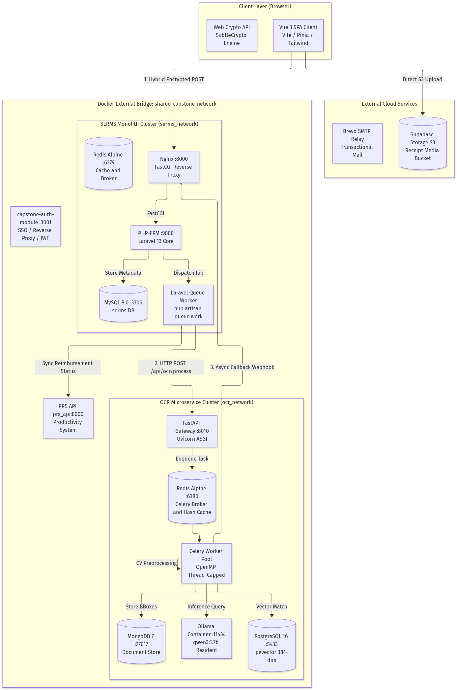
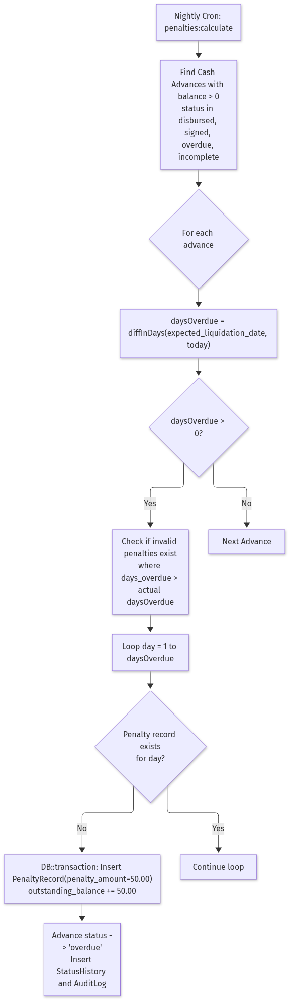
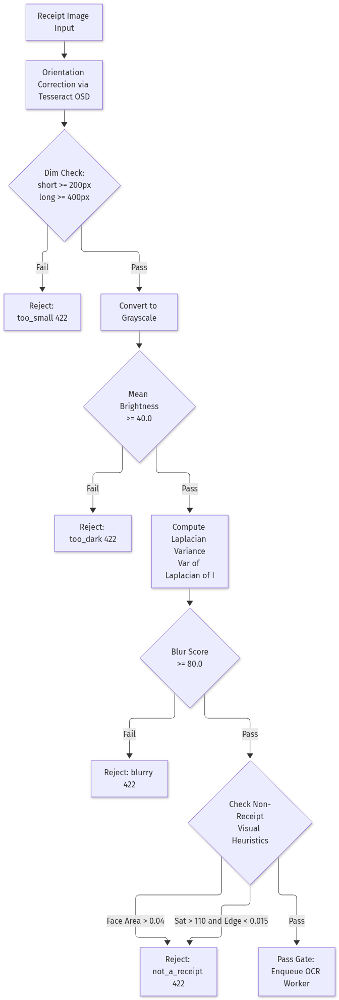
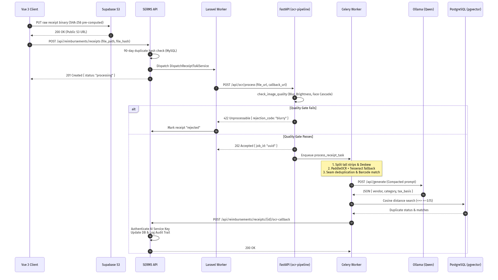

# Technical Implementation Details: SERMS & OCR Pipeline
**System:** Smart Expense & Reimbursement Management System (SERMS) & External AI OCR Microservice  
**Client / Partner:** Science Biotech Specialties Inc. (SBSI)  
**Classification:** Deep Technical Architecture & Code-Level Engineering Specification  
**Canonical Spec:** [SERMS.md](SERMS.md) · **Related Docs:** [index.md](index.md) · [SAD.md](SAD.md) · [SDD.md](SDD.md) · [TECH_STACK_AND_TOOLS.md](TECH_STACK_AND_TOOLS.md) · [IMPLEMENTED_FEATURES.md](IMPLEMENTED_FEATURES.md) · [KNOWN_ISSUES_AND_LIMITATIONS.md](KNOWN_ISSUES_AND_LIMITATIONS.md) · [API_DOCUMENTATION_AND_INTEGRATION.md](API_DOCUMENTATION_AND_INTEGRATION.md)  
**Document Format:** [TECHNICAL_IMPLEMENTATION_DETAILS.docx](TECHNICAL_IMPLEMENTATION_DETAILS.docx) (Word / Google Docs Format)  
**Date:** Nov 6, 2026  
**Status:** Complete Implementation Reference  

---

## 1. System Topology & Cross-Network Execution Model

SERMS operates as a **Modular Monolith** deployed alongside an asynchronous, event-driven AI microservice (**`ocr-pipeline`**) over an isolated internal Docker bridge and a shared cross-project network.

  
*Figure 1: High-Level System Topology & Cross-Network Execution Model*

---

## 2. Cryptography & Security Subsystem

### 2.1 Native Web Crypto Hybrid Pre-Encryption
To prevent plaintext leakage, memory snooping, or shoulder theft of sensitive financial mutations, the client implements hybrid envelope pre-encryption (`apps/web/src/utils/crypto.js`) prior to HTTP transmission.

1. **Key Fetching:** The client retrieves the server's public key from `GET /api/crypto/key` (cached in memory):
   $$\text{Server Public Key} \in \text{RSA-OAEP-2048, SHA-256}$$
2. **Ephemeral Key Generation:** For each request, the browser generates an ephemeral symmetric key:
   $$K_{\text{AES}} \leftarrow \text{AES-GCM-256},\quad IV \leftarrow \text{Random}(12 \text{ bytes})$$
3. **Payload Ciphertext:**
   $$C = \text{AES-256-GCM}_{K_{\text{AES}}, IV}(\text{JSON Payload}) \,\|\, \text{Tag}_{16\text{B}}$$
4. **Wrapped Key:**
   $$W_K = \text{RSA-OAEP-SHA256}_{\text{ServerPubKey}}(K_{\text{AES}})$$
5. **Wire Envelope:**
   ```json
   {
     "encryptedKey": "base64(W_K)",
     "iv": "base64(IV)",
     "ciphertext": "base64(C)"
   }
   ```

---

### 2.2 Server-Side Pure-PHP PKCS#1 v2.2 OAEP Decryption
PHP's native `openssl_private_decrypt()` only supports OAEP with SHA-1. Because modern browsers (Web Crypto API) require SHA-256 for RSA-OAEP, SERMS implements a pure-PHP PKCS#1 v2.2 decoding engine inside [`PayloadDecryptionService.php`](file:///c:/Projects/smart-expense-management-system/apps/api/app/Modules/Shared/Services/PayloadDecryptionService.php):

1. **Raw RSA Operation:** Decrypts ciphertext using `OPENSSL_NO_PADDING`:
   $$EM = \text{RawRSA}(W_K, K_{\text{private}})$$
   If OpenSSL strips leading zero bytes, $EM$ is left-padded to $k = 256$ bytes.
2. **EME-OAEP Mask Generation (MGF1):**
   $$hLen = 32 \text{ bytes (SHA-256)}$$
   $$EM = 0x00 \,\|\, \text{maskedSeed}_{hLen} \,\|\, \text{maskedDB}_{k - hLen - 1}$$
   $$\text{seedMask} = \text{MGF1}(\text{maskedDB}, hLen, \text{"sha256"})$$
   $$\text{seed} = \text{maskedSeed} \oplus \text{seedMask}$$
   $$\text{dbMask} = \text{MGF1}(\text{seed}, k - hLen - 1, \text{"sha256"})$$
   $$DB = \text{maskedDB} \oplus \text{dbMask}$$
3. **Verification & Plaintext Extraction:**
   - Validates that $DB[0 \dots hLen] == \text{SHA256}(\text{""})$ (empty label).
   - Scans $DB$ for the $0x01$ byte separator.
   - Extracts $K_{\text{AES}}$ from the remainder of $DB$.
4. **Symmetric Decryption:**
   $$P = \text{openssl\_decrypt}(\text{cipherBytes}, \text{"aes-256-gcm"}, K_{\text{AES}}, \text{OPENSSL\_RAW\_DATA}, IV, \text{Tag}_{16\text{B}})$$
   Transparently injected into the `$request` lifecycle by [`DecryptPayloadMiddleware`](file:///c:/Projects/smart-expense-management-system/apps/api/app/Modules/Shared/Http/Middleware/DecryptPayloadMiddleware.php).

---

### 2.3 Atomic Idempotency Middleware
Financial mutation endpoints are protected by [`EnsureIdempotency.php`](file:///c:/Projects/smart-expense-management-system/apps/api/app/Modules/Shared/Http/Middleware/EnsureIdempotency.php):
- **Key Extraction:** Reads `X-Idempotency-Key` or `Idempotency-Key` header.
- **Request Fingerprint:** Computes deterministic payload signature:
  $$H_{\text{req}} = \text{SHA-256}(\text{Method} \,\|\, \text{Path} \,\|\, \text{JSON}(\text{ksort}(\text{Payload})))$$
- **Atomic Pending Lock:** Inserts a row into `idempotency_keys` with `status = 'pending'`.
  - If a concurrent duplicate request hits the database simultaneously, MySQL throws a `QueryException` (unique key violation on `idempotency_key`), immediately aborting the duplicate with `409 Conflict`.
- **Cached Replay:** If the record exists and `status = 'completed'`, it verifies $H_{\text{req}}$ matches and replays the cached HTTP status, headers, and body with `X-Idempotent-Replay: true`.

---

## 3. SERMS Financial Compliance & Business Math Engine

### 3.1 Daily Overdue Penalty Accrual
Automated via [`ComputeDailyPenalties.php`](file:///c:/Projects/smart-expense-management-system/apps/api/app/Console/Commands/ComputeDailyPenalties.php) running nightly at 00:00:

  
*Figure 2: Daily Overdue Penalty Accrual & Reversion State Machine*

- **Overdue Day Calculation:**
  $$D_{\text{overdue}} = \max\left(0, \, \left\lfloor \frac{T_{\text{today}} - T_{\text{due}}}{86400} \right\rfloor\right)$$
- **Penalty Accrual:**
  $$\Delta P = \sum_{d=1}^{D_{\text{overdue}}} [d \notin \text{Penalties}(A)] \times 50.00$$
  $$\text{Balance}_{\text{new}} = \text{Balance}_{\text{old}} + \Delta P$$
- **Reversion Mechanism:** If an administrator officially extends the `expected_liquidation_date` in the database, invalid penalty records where $\text{days\_overdue} > D_{\text{overdue}}$ are summed, deleted in a transaction, and subtracted from `outstanding_balance` to guarantee zero mathematical drift.

---

### 3.2 Liquidation Variance Arithmetic
Handled inside [`LiquidationController.php`](file:///c:/Projects/smart-expense-management-system/apps/api/app/Modules/Liquidations/Http/Controllers/LiquidationController.php):

$$\text{Variance} = \text{Advance Amount} - \sum_{i=1}^{n} \text{Verified Receipt Amount}_i$$

1. **Overpayment Case ($\text{Variance} > 0$):**
   - The employee spent less than the cash advance.
   - Status transitions to `liquidated` once excess cash is remitted to the company cashier.
2. **Shortfall Case ($\text{Variance} < 0$):**
   - The employee spent out-of-pocket funds exceeding the advance.
   - System mandates a `shortfall_explanation` ($\ge 20$ characters) justifying the variance before the submission can be dispatched for audit.

---

### 3.3 Philippine BIR 12% VAT Engine
Implemented in [`bir_validator.py`](file:///c:/Projects/ocr-pipeline/app/core/bir_validator.py):
- **TIN Validation:** Philippine Tax Identification Numbers must match 9-3 or 9-5 digit configurations (12 or 14 total numeric digits):
  $$\text{len}(\text{digits\_only}(\text{TIN})) \in \{12, 14\}$$
- **Registration Marker Hierarchy:** To prevent column headings (like "VATable Sales") from triggering false positives on Non-VAT receipts, marker precedence is strictly ordered:
  1. `NON-VAT REG` or `NON VAT REG` $\rightarrow$ `non-vat`
  2. `NOT VALID FOR CLAIMING INPUT TAX` $\rightarrow$ `non-vat`
  3. `VAT REG` $\rightarrow$ `vat`
  4. Fallback keyword inspection (`NON-VAT`, `VAT-EXEMPT`, `VAT`)
- **Mathematical Tax Reconciliation:**
  $$\text{Net Sales (Tax Basis)} = \frac{\text{Gross Total}}{1.12}$$
  $$\text{VAT Amount (12\%)} = \text{Gross Total} - \text{Net Sales}$$

---

### 3.4 Zero-Overhead Audit Trail Hydration
To eliminate secondary HTTP round-trips when rendering timeline modals, [`AuditLogService.php`](file:///c:/Projects/smart-expense-management-system/apps/api/app/Modules/AuditLogs/Services/AuditLogService.php) batch-hydrates models on index and show queries:
- **Diff Sanitization:** `computeSanitizedDiff()` strips metadata keys (`id`, `created_at`, `updated_at`, `password`) and maps raw field values into formatted currency strings.
- **Privacy Masking:**
  $$\text{ip\_address} = \begin{cases} \text{raw IP}, & \text{if User has } \texttt{serms.reimbursements.manage} \\ \text{null}, & \text{otherwise} \end{cases}$$

---

## 4. `ocr-pipeline` Computer Vision & Deep Learning Engine

### 4.1 Pre-OCR Image Quality Gate & Anti-Fraud
Located in [`image_quality.py`](file:///c:/Projects/ocr-pipeline/app/core/image_quality.py):

  
*Figure 3: Multi-Stage Image Quality Gate & Anti-Fraud Pipeline*

1. **Blur Metric (Laplacian Operator):**
   $$\text{Score} = \text{Var}\left(\nabla^2 I\right) = \frac{1}{N}\sum (L(x,y) - \bar{L})^2$$
   Rejected if $\text{Score} < 80.0$.
2. **Prominent Face Detection:** Employs OpenCV Haar Cascade (`haarcascade_frontalface_default.xml`). If detected face area exceeds $4\%$ of total image area:
   $$\frac{\text{Area}_{\text{face}}}{\text{Area}_{\text{total}}} \ge 0.04 \implies \text{Reject (\texttt{not\_a\_receipt})}$$
3. **Saturation vs. Horizontal Edge Density:** Real printed receipts are largely desaturated with dense horizontal text lines:
   $$\bar{S}_{\text{HSV}} > 110.0 \quad \text{AND} \quad \frac{\sum |\text{Sobel}_x(I)|}{N} < 0.015 \implies \text{Reject (\texttt{not\_a\_receipt})}$$

---

### 4.2 Multi-Segment Auto-Tiling & Seam Stitching
Located in [`segment_merger.py`](file:///c:/Projects/ocr-pipeline/app/core/segment_merger.py):

1. **Virtual Strip Slicing:** Single tall receipts where $\text{height} \ge 1800\text{px}$ and $\text{aspect} \ge 2.8$ are sliced into overlapping horizontal strips (up to 10 strips) with a $15\%$ vertical overlap margin.
2. **Seam Deduplication Algorithm:**
   - Extracts a fingerprint buffer of the last 30 lines of strip $N$ and the first 30 lines of strip $N+1$.
   - **Barcode Matching:** 7-digit common barcode suffix matches award a score of $+3.0$.
   - **Price Match + Text Match:** Exact line price match with RapidFuzz token set ratio $\ge 80\%$ awards $+2.5$.
   - The longest contiguous block with $\text{Score} \ge 2.0$ defines the seam boundary. Lines preceding the seam in strip $N+1$ are deduplicated and dropped.

---

### 4.3 Dual-Engine OCR & Thread Optimization
Located in [`ocr_engine.py`](file:///c:/Projects/ocr-pipeline/app/core/ocr_engine.py):
- **PaddleOCR 3.7 Primary:** Evaluates upright text blocks and bounding boxes via deep learning models (`DBNet` detection + `SVTR` recognition).
- **Tesseract 5 Fallback:** If PaddleOCR anchors score $< 4.0$ or fast-path money reconciliation fails, single-pass OpenCV + Tesseract is invoked.
- **OpenMP Multi-Threading Fix:**
  - OpenCV and Tesseract default to multi-threaded OpenMP teams (8 threads per process).
  - Without limits, 6 concurrent subprocesses thrash CPU cores, slowing execution from 12s to 309s (**26x slower**).
  - **Hard Optimization:** Container environment variables strictly enforce:
    ```bash
    export OMP_NUM_THREADS=1
    export OMP_THREAD_LIMIT=1
    ```
    This reduces grid execution time down to $\approx 4\text{ seconds}$ with identical OCR readings.

---

### 4.4 Local LLM Extraction Assist (Ollama)
Located in [`ollama_provider.py`](file:///c:/Projects/ocr-pipeline/app/llm/ollama_provider.py):
- **Model:** `qwen3:1.7b` (or `qwen2.5:1.5b`) running via Ollama container on port `11434`.
- **Memory Residency:** Auto-warmed on boot with `keep_alive = -1` (integer representation) to eliminate cold-start weight loading.
- **Prompt Compaction (`compact_text_for_llm`):** Clamped to fit `num_ctx = 2048`:
  - Retains first 30 header lines (Merchant, TIN, Date, Invoice #).
  - Retains last 35 footer lines (Subtotal, VAT, Total, Tender).
  - Omits middle line items from the prompt to keep inference latency under $10\text{s}$.
- **Soft-Fail Architecture:** The LLM only assists with vendor normalization, category selection, and tax basis. If Ollama times out ($> 20.0\text{s}$) or generates invalid JSON, the pipeline catches the error and falls back to deterministic regex extraction.

---

### 4.5 Vector Embeddings & `pgvector` Cosine Similarity
Located in [`similarity.py`](file:///c:/Projects/ocr-pipeline/app/embeddings/similarity.py):
- **Embedding Generation:** Sentence-Transformers (`all-MiniLM-L6-v2`) generates a 384-dimensional dense vector:
  $$\vec{v} \in \mathbb{R}^{384}, \quad \|\vec{v}\|_2 = 1.0$$
- **Cosine Similarity Lookup:**
  $$\text{Cosine Distance} = 1 - \frac{\vec{u} \cdot \vec{v}}{\|\vec{u}\| \|\vec{v}\|} = \vec{u} \Leftrightarrow \vec{v}$$
- **SQLAlchemy AsyncPG Query:**
  ```sql
  SELECT receipt_id, source_service, created_at,
         (embedding <=> :query_vector) AS distance
  FROM receipt_embeddings
  WHERE source_service = :service
    AND created_at >= NOW() - INTERVAL '90 days'
    AND (embedding <=> :query_vector) <= 0.15
  ORDER BY distance ASC
  LIMIT 10;
  ```
  A distance $\le 0.15$ ($\text{Similarity} \ge 0.85$) flags the receipt as a duplicate (`rejection_code: "duplicate"`).

---

## 5. End-to-End Execution Sequence & State Lifecycles

  
*Figure 4: Asynchronous Cross-Service Receipt Processing Sequence*

---

## 6. Technical Implementation Summary Matrix

| Subsystem | Core Implementation File | Primary Algorithm / Class | Performance / Security Guardrail |
|---|---|---|---|
| **Payload Pre-Encryption** | `apps/web/src/utils/crypto.js` | Native SubtleCrypto (`AES-GCM` + `RSA-OAEP`) | Client-side ephemeral keying; zero plaintext transmission. |
| **Payload Decryption** | `PayloadDecryptionService.php` | PKCS#1 v2.2 OAEP-SHA256 decoding engine | Pure PHP; circumvents OpenSSL SHA-1 limitation. |
| **Idempotency** | `EnsureIdempotency.php` | Atomic lock table `idempotency_keys` | MySQL unique constraint prevents double-charging. |
| **Daily Penalties** | `ComputeDailyPenalties.php` | `penalties:calculate` CLI command | Idempotent insertion; auto-reversion on date extension. |
| **Audit Hydration** | `AuditLogService.php` | `enrichReimbursements`, `enrichCashAdvances` | Single SQL batch enrichment; role-scoped IP masking. |
| **Quality Gate** | `app/core/image_quality.py` | Laplacian variance + Haar Cascade filter | Rejects blurry photos and non-receipt selfies at API gate. |
| **Seam Stitching** | `app/core/segment_merger.py` | 30-line fingerprint buffer + Barcode matcher | Prevents duplicate line items on folding receipts. |
| **OCR Pool** | `app/core/ocr_engine.py` | PaddleOCR primary + Tesseract OSD fallback | `OMP_NUM_THREADS=1` eliminates 26x CPU thrash penalty. |
| **LLM Semantic Assist** | `app/core/pipeline.py` | Ollama `qwen3:1.7b` non-thinking JSON mode | Prompt head/tail compaction; fails soft to regex. |
| **Vector Deduplication**| `app/embeddings/similarity.py` | `pgvector` Cosine Distance (`<=> <= 0.15`) | 384-dimensional dense semantic matching over 90 days. |
