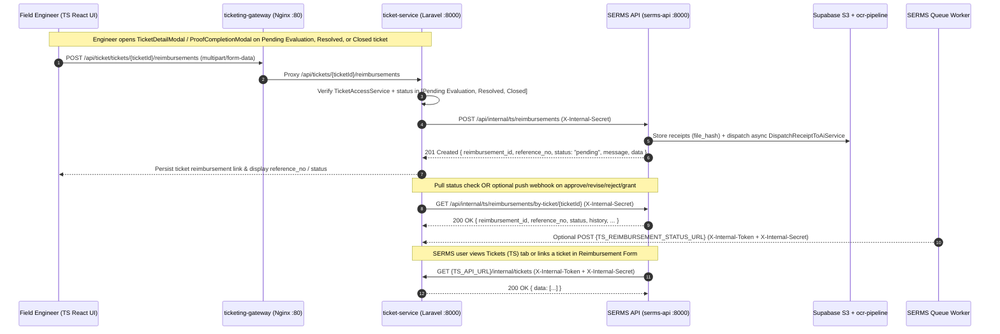

# Ticketing System (TS) ↔ SERMS Integration Handoff & Contract Guide

**Project:** Smart Expense & Reimbursement Management System (SERMS) ↔ Ticketing System (TS)  
**Client / Partner:** Science Biotech Specialties Inc. (SBSI)  
**Date:** Nov 21, 2026  
**Version:** 1.0.0  
**Status:** Active Handoff Specification  
**Last reconciled:** Nov 21, 2026 (Locked SERMS ↔ TS integration contract & cross-team handoff)  
**Canonical Spec:** [SERMS.md](SERMS.md) · **Related Docs:** [CHANGELOG.md](CHANGELOG.md) · [DOC_CHANGELOG.md](DOC_CHANGELOG.md) · [index.md](index.md)

---

> **What this is:** The authoritative cross-repository integration contract, TS implementation blueprint, deployment/port-forwarding runbook, verification suite, and copy-paste TS agent prompt connecting **SERMS** (`Scientific-Biotech-Specialties-Inc/smart-expense-management-system`) with **TS** (`Scientific-Biotech-Specialties-Inc/ticketing`, branch `main`).

---

## 1. Architecture Overview

SBSI field engineers resolve service tickets in **TS** (`ticketing-gateway` + `ticket-service` + `frontend/web`) and submit ticket-linked expense reimbursements into **SERMS** (`serms-api` + `serms-worker`). Conversely, SERMS allows authenticated users to browse TS tickets, link reimbursements to tickets (`ticket_id`, `ticket_number`), and synchronize reimbursement lifecycle outcomes (`pending`, `approved`, `revise`, `rejected`, `granted`) back to TS via pull lookups or optional webhook pushes.



### Verified TS & Infrastructure Baseline

| Component | Verified Source | Locked Fact |
|---|---|---|
| **TS Repo** | `Scientific-Biotech-Specialties-Inc/ticketing` (`main`) | Laravel microservices behind `ticketing-gateway` + React (`frontend/web`) |
| **Gateway Config** | `nginx.gateway.conf.template` | `client_max_body_size 30M`; routes `/api/ticket/*` → `ticket-service/api/*` |
| **TS Auth Middleware** | `services/ticket-service/routes/api.php` | Alias `internal.token` (`App\Http\Middleware\VerifyInternalToken`) checks `X-Internal-Token` against `INTERNAL_TOKEN` |
| **Azure Infra** | `capstone-azure-infra/infra/modules/ticketing.bicep` | Injects both `INTERNAL_TOKEN` and `INTERNAL_SERVICE_SECRET` on all 9 TS microservices from the same `internalToken` secret |
| **TS Schema** | `tickets` & `ticket_statuses` tables | `ticket_ID` (PK), `ticket_number` (`TKT-0001`), `title`, `assigned_to`, `ticket_status_ID` → `ticket_statuses.status_name` (`Pending Evaluation`, `Resolved`, `Closed`, `In Progress`, `Open`, `Discarded`) |
| **TS Access Control** | `TicketAccessService` | Checks ticket assignee, delegated `ticket_assignments`, and CS/admin/manager access |
| **TS React Modals** | `frontend/web/src/components/employee/` | `TicketDetailModal.jsx` and `ProofCompletionModal.jsx` |

---

## 2. SERMS ↔ TS API Contract Reference

### 2.1 Authentication & Required Headers

| Direction | Middleware / Verifier | Headers Sent | Env Secret Source | Failure Status |
|---|---|---|---|---|
| **TS → SERMS** (`/api/internal/ts/*`) | SERMS `auth.internal` (`AuthenticateInternalService`) | `X-Internal-Secret: <secret>` | Checks `config('services.ts.internal_secret')` first for `/api/internal/ts*`, then `config('services.cms.internal_secret')` (and `TS_INTERNAL_SECRET` → `INTERNAL_SERVICE_SECRET` env fallbacks), via `hash_equals()` | `401 Unauthorized` |
| **SERMS → TS** (`{TS_API_URL}/internal/tickets`, `{TS_REIMBURSEMENT_STATUS_URL}`) | TS `internal.token` (`VerifyInternalToken`) | **Both** `X-Internal-Token: <secret>` **and** `X-Internal-Secret: <secret>` | `TS_INTERNAL_SECRET ?: INTERNAL_SERVICE_SECRET` | `401 Unauthorized` |
| **SERMS Browser → SERMS API** (`/api/serms/ts/tickets` → `/api/ts/tickets`) | SERMS `auth.external` (`AuthenticateWithExternalService`) | `Authorization: Bearer <JWT>` (or `access_token` cookie via `auth-proxy`) | `JWT_SECRET` / `AUTH_SERVICE_URL` | `401 Unauthorized` |

---

### 2.2 Inbound: Submit Reimbursement from TS → SERMS

- **Endpoint:** `POST /api/internal/ts/reimbursements` (via `auth-proxy`: `POST /api/serms/internal/ts/reimbursements`)
- **Middleware:** `auth.internal`
- **Content-Type:** `multipart/form-data`
- **Headers:**
  - `X-Internal-Secret: <INTERNAL_SERVICE_SECRET>`
  - `Accept: application/json`

#### Request Fields

| Field | Accepted Alias | Type | Required | Rules & Notes |
|---|---|---|---|---|
| `ticket_id` | — | integer | Yes | `>= 1`, references TS `tickets.ticket_ID` |
| `ticket_number` | — | string | Yes | Max `64` chars, e.g. `TKT-0042` |
| `employee_email` | `employee[email]` | string (email) | Yes | Resolves or provisions the SERMS `User` record |
| `employee_name` | `employee[name]` | string | Yes | Max `255` chars |
| `employee_id` | `employee[id]` | string / int | No | Optional external employee identifier (max `64` chars) |
| `department` | `employee[department]` | string | No | Max `255` chars; defaults to `'Field Service'` if omitted |
| `amount` | — | numeric | Yes | `>= 0.01` (PHP) |
| `expense_category` | `expense_category_id` | int or string | No* | Category ID or name (max `100` chars; e.g. `Travel`, `Meals`, `Supplies`, `Accommodation`, `Transportation`, `Others`); validates numeric ID exists or resolves/creates string name |
| `description` | `purpose` | string | Yes | Claim purpose / justification (**max `255` chars**) |
| `expense_date` | `date` | date | Yes | ISO `YYYY-MM-DD` for API/DB storage |
| `receipts[]` | `attachments[]` | file[] | Yes | Minimum `1` file; allowed MIME/ext: `jpeg`, `jpg`, `png`, `pdf`; max `2048` KB (`2 MB`) per file |

#### Processing & Cardinality Rules

1. **Cardinality (1 Active Claim per `ticket_id`):**
   - SERMS checks existing `Reimbursement` rows for `ticket_id` (ordered newest-first).
   - If an active claim exists (`status !== 'rejected'`), SERMS **does not duplicate** it and returns **`200 OK`** with the existing `{ reimbursement_id, reference_no, status, message, data }`.
   - If the prior claim reached terminal **`rejected`**, TS may submit a fresh reimbursement for the same `ticket_id` (`201 Created`).
2. **Receipt Storage & OCR Pipeline:**
   - Each uploaded receipt is stored on the `supabase` S3 disk via `ReceiptService` helpers with a SHA-256 `file_hash`, checked against the 90-day duplicate receipt policy, persisted with `is_draft = false` and `status = 'processing'`, and dispatched asynchronously via `DispatchReceiptToAiService`.
   - If validation or the DB transaction fails after upload, uploaded Supabase objects are cleaned up automatically.
3. **Atomic Persistence & Audit:**
   - Creates `Reimbursement` with `status = 'pending'`, `source_system = 'ts'`, `ticket_id`, `ticket_number`, `is_request = true`, and computed `reference_no` (`RMB-YYYY-00000`, e.g. `RMB-2026-00042`).
   - Sends user and admin notifications via `NotificationService` and records `TS_REIMBURSEMENT_RECEIVED` via `AuditLogService::log()` inside the same `DB::transaction()`.

#### Responses

- **`201 Created` (New Reimbursement Created):**
```json
{
  "reimbursement_id": 42,
  "reference_no": "RMB-2026-00042",
  "status": "pending",
  "message": "TS reimbursement request received and queued for OCR processing.",
  "data": {
    "id": 42,
    "reference_no": "RMB-2026-00042",
    "ticket_id": 108,
    "ticket_number": "TKT-0108",
    "source_system": "ts",
    "status": "pending",
    "amount": "1250.00",
    "date": "2026-11-21T00:00:00.000000Z",
    "receipts": [],
    "audit_trail": []
  }
}
```

- **`200 OK` (Idempotent Retry While Active Claim Exists):**
```json
{
  "reimbursement_id": 42,
  "reference_no": "RMB-2026-00042",
  "status": "pending",
  "message": "Reimbursement already exists for this ticket.",
  "data": {
    "id": 42,
    "reference_no": "RMB-2026-00042",
    "ticket_id": 108,
    "ticket_number": "TKT-0108",
    "status": "pending"
  }
}
```

- **Error Responses:**
  - `401 Unauthorized`: `{ "message": "Unauthorized." }` — missing, empty, or invalid `X-Internal-Secret`.
  - `403 Forbidden`: `{ "message": "Forbidden." }` — unauthorized action/policy boundary.
  - `422 Unprocessable Entity`: `{ "message": "The given data was invalid.", "errors": { "receipts.0": ["..."] } }` — invalid fields, file > 2MB, unsupported file type, or 90-day duplicate conflict.

---

### 2.3 Inbound: Pull Reimbursement Status by Ticket ID

- **Endpoint:** `GET /api/internal/ts/reimbursements/by-ticket/{ticketId}`
- **Middleware:** `auth.internal`
- **Headers:** `X-Internal-Secret: <INTERNAL_SERVICE_SECRET>`, `Accept: application/json`

#### Responses

- **`200 OK`:**
  - `message` is derived from `UpdateTsReimbursementStatusJob::statusMessage($status)` (see status table in §2.6).
  - `amount` is returned as a JSON float (`(float) $reimbursement->amount`).
  - `history` is the `AuditLogService` `audit_trail` array (`id`, `domain`, `domain_label`, `action_type`, `label`, `tone`, `actor_name`, `actor_role`, `ip_address`, `comment`, `changes`, `created_at`), with `ip_address: null` for service-to-service visibility.
```json
{
  "reimbursement_id": 42,
  "reference_no": "RMB-2026-00042",
  "status": "approved",
  "message": "Reimbursement request has been approved.",
  "ticket_id": 108,
  "ticket_number": "TKT-0108",
  "amount": 1250,
  "rejection_comment": null,
  "approved_at": "2026-11-21T14:45:00+00:00",
  "updated_at": "2026-11-21T14:45:00+00:00",
  "history": [
    {
      "id": 101,
      "domain": "ts",
      "domain_label": "Ticketing Integration",
      "action_type": "TS_REIMBURSEMENT_RECEIVED",
      "label": "Received from Ticketing System",
      "tone": "info",
      "actor_name": "Juan Dela Cruz",
      "actor_role": "Employee",
      "ip_address": null,
      "comment": null,
      "changes": [],
      "created_at": "2026-11-21T14:30:00+00:00"
    },
    {
      "id": 102,
      "domain": "reimbursement",
      "domain_label": "Reimbursement",
      "action_type": "CLAIM_APPROVED",
      "label": "Approved",
      "tone": "success",
      "actor_name": "Finance Approver",
      "actor_role": "Approver",
      "ip_address": null,
      "comment": null,
      "changes": [
        { "field": "Status", "from": "pending", "to": "approved" }
      ],
      "created_at": "2026-11-21T14:45:00+00:00"
    }
  ]
}
```
- **`401 Unauthorized`:** Missing or invalid `X-Internal-Secret`.
- **`404 Not Found`:** `{ "message": "No reimbursement found for the specified ticket." }` when `ticketId` has no SERMS reimbursement.

---

### 2.4 Outbound: SERMS Pulls TS Ticket List

1. **SERMS Browser → SERMS Backend:** `GET /api/ts/tickets?search=&status=&limit=100` (via Vite/proxy: `GET /api/serms/ts/tickets`)
   - Middleware: `auth.external` (`401 Unauthorized` if unauthenticated; `403 Forbidden` if denied by auth policy).
2. **SERMS Backend → TS (`TsClientService`):** `GET {TS_API_URL}/internal/tickets?search=&status=&limit=100`
   - Headers sent by SERMS:
     - `X-Internal-Token: <TS_INTERNAL_SECRET or INTERNAL_SERVICE_SECRET>`
     - `X-Internal-Secret: <TS_INTERNAL_SECRET or INTERNAL_SERVICE_SECRET>`
     - `Accept: application/json`

#### Expected TS Response (`GET {TS_API_URL}/internal/tickets`)

```json
{
  "data": [
    {
      "ticket_id": 108,
      "ticket_number": "TKT-0108",
      "title": "Analyzer Calibration — St. Luke's QC",
      "status": "Resolved",
      "priority": "High",
      "assignee_name": "Juan Dela Cruz",
      "assignee_email": "employee@example.com",
      "department": "Operations",
      "created_at": "2026-11-20T08:15:00Z",
      "updated_at": "2026-11-21T10:30:00Z"
    }
  ]
}
```

#### SERMS Enriched Response (`GET /api/ts/tickets`)

SERMS batch-hydrates linked reimbursements in **one** `whereIn('ticket_id', ...)` query (zero N+1 queries) and returns graceful fallback if TS is offline:

```json
{
  "available": true,
  "data": [
    {
      "ticket_id": 108,
      "ticket_number": "TKT-0108",
      "title": "Analyzer Calibration — St. Luke's QC",
      "status": "Resolved",
      "priority": "High",
      "assignee_name": "Juan Dela Cruz",
      "assignee_email": "employee@example.com",
      "department": "Operations",
      "created_at": "2026-11-20T08:15:00Z",
      "updated_at": "2026-11-21T10:30:00Z",
      "reimbursement": {
        "reimbursement_id": 42,
        "reference_no": "RMB-2026-00042",
        "status": "pending",
        "amount": 1250,
        "reimbursement_status": "pending",
        "reimbursement_amount": 1250
      }
    }
  ]
}
```
When TS is unreachable or unconfigured, SERMS returns `200 OK` with `{ "available": false, "data": [], "error": "..." }` so the SERMS UI displays a non-blocking banner instead of crashing.

---

### 2.5 Optional Outbound: Status Webhook Push (SERMS → TS)

When a TS-linked reimbursement (`source_system === 'ts'` or `ticket_id` is non-empty) transitions via `approveReimbursement()`, `rejectReimbursement()` (`revise` or `rejected`), or `grantReimbursement()`, SERMS queues `UpdateTsReimbursementStatusJob` (`ShouldQueue`).

- **Target:** `POST {TS_REIMBURSEMENT_STATUS_URL}` (skipped cleanly with an info log if unconfigured)
- **Headers:**
  - `X-Internal-Token: <TS_INTERNAL_SECRET or INTERNAL_SERVICE_SECRET>`
  - `X-Internal-Secret: <TS_INTERNAL_SECRET or INTERNAL_SERVICE_SECRET>`
  - `Content-Type: application/json`
  - `Accept: application/json`
- **Payload (`UpdateTsReimbursementStatusJob`):**
```json
{
  "ticket_id": 108,
  "ticket_number": "TKT-0108",
  "reimbursement_id": 42,
  "reference_no": "RMB-2026-00042",
  "status": "approved",
  "message": "Reimbursement request has been approved.",
  "rejection_comment": null,
  "updated_at": "2026-11-21T14:45:00+00:00"
}
```
> **PRS Isolation Guarantee:** `ReimbursementService::approveReimbursement()` and `grantReimbursement()` strictly guard `UpdatePrsReimbursementStatusJob::dispatch(...)` with `$reimbursement->source_system === 'prs'`. TS claims never trigger PRS webhooks.

---

### 2.6 SERMS Reimbursement Status Reference

| `status` | `UpdateTsReimbursementStatusJob::statusMessage()` | Meaning in SERMS | TS Action Allowed? |
|---|---|---|---|
| `pending` | `"Reimbursement request is pending review."` | Submitted and awaiting accounting review | Active — retry returns `200 OK` (no duplicate) |
| `revise` | `"Reimbursement request was returned for revision."` | Returned by accounting for revision (strikes 1–2); includes `rejection_comment` | Active — employee edits in SERMS; retry returns `200 OK` |
| `approved` | `"Reimbursement request has been approved."` | Approved by accounting; awaiting payout grant | Active — locked in TS |
| `granted` | `"Reimbursement payout has been granted."` | Disbursed (`Payout` created); awaiting/completed employee acknowledgement | Active — terminal positive state |
| `rejected` | `"Reimbursement request has been rejected."` | Terminally rejected (explicit reject or > 2 revision strikes); includes `rejection_comment` | **Resubmission Allowed** — TS may submit a new claim |

---

## 3. TS-Side Implementation Plan (`Scientific-Biotech-Specialties-Inc/ticketing`)

### 3.1 `ticketing-gateway` (`nginx.gateway.conf.template`)

1. Confirm `client_max_body_size 30M;` remains enabled (accommodates multi-file <= 2MB receipts comfortably).
2. Ensure `/api/ticket/*` proxies to `ticket-service` (`/api/*`) and forwards:
   - `Authorization`, `Cookie` (user session/JWT)
   - `X-Internal-Token`, `X-Internal-Secret` (internal S2S calls when `TS_API_URL` routes via gateway)
   - Multipart `Content-Type` and `proxy_pass_request_body on`
3. If `TS_API_URL` targets `ticketing-gateway` directly (e.g. `https://ticketing-gateway.../api/ticket`), confirm `/api/ticket/internal/*` is reachable by SERMS and strictly gated by `VerifyInternalToken` on `ticket-service` (never accessible without valid token).

### 3.2 `services/ticket-service` Backend

1. **Middleware (`App\Http\Middleware\VerifyInternalToken`):**
   - Keep validating `X-Internal-Token` against `INTERNAL_TOKEN` using constant-time `hash_equals()`.
   - Optionally accept `X-Internal-Secret` validated against `INTERNAL_SERVICE_SECRET ?: INTERNAL_TOKEN` as fallback so either header works identically while SERMS sends both. Return `401 Unauthorized` on missing/invalid headers.

2. **Config & Env (`services/ticket-service/config/services.php` & `.env.example`):**
   ```php
   'serms' => [
       'api_url'         => env('SERMS_API_URL'),
       'internal_secret' => env('INTERNAL_SERVICE_SECRET') ?: env('INTERNAL_TOKEN'),
       'timeout'         => (int) env('SERMS_TIMEOUT', 15),
   ],
   ```

3. **Database Migration (`services/ticket-service/database/migrations/`):**
   Create a `ticket_reimbursements` table (recommended over single columns on `tickets` so prior terminally `rejected` attempts remain auditable while tracking the active claim):
   - `id` (PK)
   - `ticket_ID` (unsignedBigInteger, indexed, FK to `tickets.ticket_ID`)
   - `ticket_number` (`string(64)`)
   - `reimbursement_id` (unsignedBigInteger, nullable, indexed)
   - `reference_no` (`string(64)`, nullable)
   - `status` (`string(32)`, default `'pending'`)
   - `amount` (`decimal(15,2)`)
   - `expense_category` (`string(100)`)
   - `description` (`text`)
   - `expense_date` (`date`)
   - `message` (`text`, nullable)
   - `rejection_comment` (`text`, nullable)
   - `submitted_by_user_id` (unsignedBigInteger, nullable)
   - `synced_at` (`timestamp`, nullable)
   - `timestamps()`

4. **Routes (`services/ticket-service/routes/api.php`):**
   - **Authenticated User Routes (behind TS auth middleware):**
     - `POST /tickets/{ticketId}/reimbursements` → `TicketReimbursementController@store`
     - `GET /tickets/{ticketId}/reimbursement` → `TicketReimbursementController@show`
   - **Internal S2S Routes (`middleware('internal.token')`):**
     - `GET /internal/tickets` → `InternalTicketController@index`
     - `POST /internal/reimbursements/status` → `InternalTicketController@updateReimbursementStatus`

5. **Controller Rules (`TicketReimbursementController` & `InternalTicketController`):**
   - **Access Check (`TicketAccessService`):** Verify the authenticated user is the assigned engineer (`tickets.assigned_to`) or a delegated engineer in `ticket_assignments` (and/or allowed supervisor/admin per TS policy). Return `403 Forbidden` otherwise.
   - **Ticket Status Gate:** Load `tickets` joined with `ticket_statuses`. Require `status_name` in `['Pending Evaluation', 'Resolved', 'Closed']`. Return `422 Unprocessable Entity` if the ticket is `Open`, `In Progress`, or `Discarded`.
   - **Cardinality Guard:** Check local `ticket_reimbursements` (or pull SERMS) — if an active non-rejected reimbursement exists, return it (`200 OK`) or reject duplicate form submit cleanly. Allow fresh submission if latest `status === 'rejected'`.
   - **Validation before Proxy (`422`):**
     - `amount`: required numeric `min:0.01`
     - `expense_category`: required string/int
     - `description` (or `purpose`): required string, max `255` chars (`reimbursements.description` column limit)
     - `expense_date`: required date (`YYYY-MM-DD`)
     - `receipts` (or `receipts.*` / `attachments.*`): required array min `1`, mimes `jpeg,jpg,png,pdf`, max `2048` KB per file
   - **Multipart Forward (`try-catch` boundary):**
     - Forward `multipart/form-data` to `POST {SERMS_API_URL}/api/internal/ts/reimbursements` with `X-Internal-Secret: config('services.serms.internal_secret')` using Laravel `Http::attach(...)`.
     - Propagate SERMS `422` errors cleanly to the React UI; log and return `502 Bad Gateway` / `503 Service Unavailable` if SERMS is unreachable (zero silent catch blocks).
     - On `201` / `200`, upsert `ticket_reimbursements` with `reimbursement_id`, `reference_no`, `status`, `message`, `synced_at` and return JSON `{ reimbursement_id, reference_no, status, message, data }` to the UI.
   - **Status Sync (`show` & `updateReimbursementStatus`):**
     - `show`: fetch latest from SERMS `GET /api/internal/ts/reimbursements/by-ticket/{ticketId}`, update local `ticket_reimbursements` cache, and return `200 OK` (or `404` if none).
     - `updateReimbursementStatus`: validate payload `{ ticket_id, reimbursement_id, reference_no, status, message, rejection_comment, updated_at }`, update `ticket_reimbursements`, and return `200 OK`.
   - **Ticket Feed (`GET /internal/tickets`):**
     - Query `tickets` joined with `ticket_statuses` and assignee (`employee-service` / local user cache) filtering optional `search`, `status`, and `limit` (default `100`, max `200`). Return `{ data: [ { ticket_id, ticket_number, title, status, priority, assignee_name, assignee_email, department, created_at, updated_at } ] }`.

### 3.3 `frontend/web` React UI (`TicketDetailModal.jsx` & `ProofCompletionModal.jsx`)

1. **Visibility & Authorization Rule:**
   - Show the **"Submit Reimbursement"** button/drawer inside `TicketDetailModal.jsx` **only when**:
     1. The logged-in user is the **assigned engineer** (`assigned_to`) or **delegated engineer** (`ticket_assignments`), AND
     2. Ticket `status_name` is **`Pending Evaluation`**, **`Resolved`**, or **`Closed`**.
   - In `ProofCompletionModal.jsx`: after submitting proof of completion (which moves a ticket into `Pending Evaluation` / `Resolved`), display an optional CTA **"Submit Expense Reimbursement"** that opens the reimbursement section/modal for that ticket.
2. **Form Fields & Client Validation:**
   - `amount` (numeric > 0, PHP)
   - `expense_category` (select: `Meals`, `Travel`, `Supplies`, `Accommodation`, `Transportation`, `Others`)
   - `description` (textarea: purpose / expense justification)
   - `expense_date` (date picker, defaults to today in `YYYY-MM-DD` transport)
   - `receipts[]` (file picker allowing multiple JPEG, PNG, PDF files; block files > `2 MB` client-side with an accessible inline error before submitting)
3. **Linked Reimbursement Status Card:**
   - When a reimbursement exists (`GET /api/ticket/tickets/{ticketId}/reimbursement`), render:
     - `reimbursement_id` and `reference_no` (e.g. `RMB-2026-00042`)
     - Accessible `status` badge (non-color-only text label: `Pending`, `Needs Revision`, `Approved`, `Granted`, `Rejected`)
     - `message` and `rejection_comment` (when `revise` or `rejected`)
     - **Refresh Status** button calling `GET /api/ticket/tickets/{ticketId}/reimbursement`
     - Hide new-submission form while `status !== 'rejected'`; re-enable **"Resubmit Reimbursement"** only if `status === 'rejected'`.
   - Format all displayed dates in **Medium Date Format** (e.g. `Nov 21, 2026`).

---

## 4. Local Port-Forwarding vs Production Azure Deployment

> [!CAUTION]
> **PRODUCTION SECRET ROTATION WARNING:**  
> Setting `INTERNAL_SERVICE_SECRET=secret` (and `INTERNAL_TOKEN=secret`) is **strictly for local / port-forwarded development testing ONLY**. Never use weak/literal secrets such as `secret` in staging or production. Before deploying to Azure Container Apps or SBSI servers, rotate `internalEncryptionKey` / `INTERNAL_SERVICE_SECRET` / `INTERNAL_TOKEN` to a cryptographically random value of **at least 32 bytes** (e.g. `openssl rand -hex 32`), store it only in `secrets.prod.json` / Azure Container Apps Secrets, and never commit secrets to Git.

### 4.1 Environment Variable Matrix

| Variable | System | Local / Port-Forward Example | Production (Azure Container Apps) |
|---|---|---|---|
| `INTERNAL_SERVICE_SECRET` | SERMS & TS | `secret` *(local test only!)* | `<32+ byte secretRef from internalEncryptionKey>` |
| `INTERNAL_TOKEN` | TS | `secret` *(local test only!)* | `<same 32+ byte secretRef>` (already wired in `ticketing.bicep`) |
| `TS_INTERNAL_SECRET` | SERMS | *(optional; falls back to `INTERNAL_SERVICE_SECRET`)* | Set only if TS rotates `INTERNAL_TOKEN` separately |
| `TS_API_URL` | SERMS | `https://<tunnel>.trycloudflare.com/api/ticketing/ticket` (via `:5173` auth proxy) or `http://host.docker.internal:8090/api/ticket` | `http://ticket-service/api` (same ACA env) or `https://<ticketing-gateway-fqdn>/api/ticket` |
| `TS_REIMBURSEMENT_STATUS_URL` | SERMS | `https://<tunnel>.trycloudflare.com/api/ticketing/ticket/internal/reimbursements/status` *(optional)* | `http://ticket-service/api/internal/reimbursements/status` *(optional)* |
| `TS_SERVICE_TIMEOUT` | SERMS | `10` | `10` |
| `SERMS_API_URL` | TS | `http://host.docker.internal:8000` or `https://<serms-tunnel>.devtunnels.ms` | `http://serms-api` (same ACA env) or `https://<serms-api-fqdn>` |

### 4.2 Local Port-Forwarding Setup (Two Developer Machines)

1. **On SERMS Host (`apps/api/.env` + `docker-compose.yml`):**
   - Set:
     ```dotenv
     INTERNAL_SERVICE_SECRET=secret
     TS_API_URL=https://<ts-tunnel>.trycloudflare.com/api/ticketing/ticket
     TS_REIMBURSEMENT_STATUS_URL=https://<ts-tunnel>.trycloudflare.com/api/ticketing/ticket/internal/reimbursements/status
     TS_SERVICE_TIMEOUT=10
     ```
   - Recreate `php` and `api_queue` containers so env vars load (`docker compose up -d php api_queue`), and run migrations (`docker compose exec php php artisan migrate`).
   - **Important Docker Networking Note:** Inside `serms_php` and `serms_api_queue`, `localhost` points to the container itself. Always use `host.docker.internal:<forwarded-port>` (when port-forwarding TS onto the SERMS host) or an HTTPS tunnel URL (VS Code Port Forwarding / Dev Tunnels / ngrok / cloudflared). If both stacks run on the same `shared-capstone-network`, use `http://ticketing-gateway/api/ticket`.
2. **On TS Host (`services/ticket-service/.env`):**
   - Set:
     ```dotenv
     INTERNAL_TOKEN=secret
     INTERNAL_SERVICE_SECRET=secret
     SERMS_API_URL=http://host.docker.internal:8000
     ```
   - Forward port `8000` (SERMS `serms_api`) to TS and port `80` / `8090` (`ticketing-gateway`) to SERMS.

### 4.3 Azure Container Apps Production Deployment (`capstone-azure-infra`)

Reference files in `capstone-azure-infra`:
- `infra/modules/ticketing.bicep`: already injects `INTERNAL_TOKEN` and `INTERNAL_SERVICE_SECRET` from `internalToken` (`internalEncryptionKey` in `apps.bicep`) across `ticket-service` and all 9 microservices, and `INTERNAL_TOKEN` on `ticketing-gateway`. Add `SERMS_API_URL` to `ticket-service` (e.g. `http://serms-api` when `deploySerms == true` in the same ACA Managed Environment, or the external HTTPS FQDN `https://<serms-api-fqdn>` in cross-subscription Mode 1).
- `infra/modules/serms.bicep`: add secret `{ name: 'internal-service-secret', value: internalServiceSecret }` (sourced from `internalEncryptionKey` in `apps.bicep`) and inject `INTERNAL_SERVICE_SECRET`, `TS_API_URL`, `TS_REIMBURSEMENT_STATUS_URL`, and `TS_SERVICE_TIMEOUT=10` on **both** `serms-api` and `serms-worker` (`serms-worker` requires these for `UpdateTsReimbursementStatusJob`).
- If TS runs on a separate student subscription (Mode 1 external), point `TS_API_URL` to `https://<ticketingGatewayFqdn>/api/ticket` (TLS over ACA external ingress).

---

## 5. End-to-End `curl` Verification Commands

Set shell variables first for local testing:

```bash
SERMS_BASE="http://localhost:8000"
TS_BASE="https://<ts-tunnel>.trycloudflare.com/api/ticketing/ticket"
SECRET="secret"
```

1. **Verify `401 Unauthorized` on invalid `X-Internal-Secret`:**
   ```bash
   curl -i -X POST "$SERMS_BASE/api/internal/ts/reimbursements" \
     -H "X-Internal-Secret: wrong-secret" \
     -H "Accept: application/json"
   ```

2. **Submit TS Reimbursement (`201 Created` using sample receipt fixture):**
   ```bash
   curl -i -X POST "$SERMS_BASE/api/internal/ts/reimbursements" \
     -H "X-Internal-Secret: $SECRET" \
     -H "Accept: application/json" \
     -F "ticket_id=108" \
     -F "ticket_number=TKT-0108" \
     -F "employee_email=employee@example.com" \
     -F "employee_name=Juan Dela Cruz" \
     -F "department=Operations" \
     -F "amount=1250.00" \
     -F "expense_category=Travel" \
     -F "description=Field analyzer calibration transport and meals" \
     -F "expense_date=2026-11-21" \
     -F "receipts[]=@docs/receipts/receipt 1.jpg"
   ```

3. **Verify Idempotent Retry on Same Active `ticket_id` (`200 OK`, returns existing `reimbursement_id` & `reference_no`):**
   ```bash
   curl -i -X POST "$SERMS_BASE/api/internal/ts/reimbursements" \
     -H "X-Internal-Secret: $SECRET" \
     -H "Accept: application/json" \
     -F "ticket_id=108" \
     -F "ticket_number=TKT-0108" \
     -F "employee_email=employee@example.com" \
     -F "employee_name=Juan Dela Cruz" \
     -F "amount=1250.00" \
     -F "expense_category=Travel" \
     -F "description=Field analyzer calibration transport and meals" \
     -F "expense_date=2026-11-21" \
     -F "receipts[]=@docs/receipts/receipt 1.jpg"
   ```

4. **Poll Status by Ticket ID (`200 OK`, or `404` for unknown ticket):**
   ```bash
   curl -i "$SERMS_BASE/api/internal/ts/reimbursements/by-ticket/108" \
     -H "X-Internal-Secret: $SECRET" \
     -H "Accept: application/json"

   curl -i "$SERMS_BASE/api/internal/ts/reimbursements/by-ticket/999999" \
     -H "X-Internal-Secret: $SECRET" \
     -H "Accept: application/json"
   ```

5. **Verify TS Internal Ticket Feed (called by SERMS `TsClientService`):**
   ```bash
   curl -i "$TS_BASE/internal/tickets?limit=20" \
     -H "X-Internal-Token: $SECRET" \
     -H "X-Internal-Secret: $SECRET" \
     -H "Accept: application/json"
   ```

6. **Verify SERMS User-Facing Proxy (`GET /api/ts/tickets`):**
   ```bash
   curl -i "$SERMS_BASE/api/ts/tickets?limit=20" \
     -H "Authorization: Bearer <USER_JWT>" \
     -H "Accept: application/json"
   ```

7. **Simulate Optional Webhook Push to TS (`POST {TS_REIMBURSEMENT_STATUS_URL}`):**
   ```bash
   curl -i -X POST "$TS_BASE/internal/reimbursements/status" \
     -H "X-Internal-Token: $SECRET" \
     -H "X-Internal-Secret: $SECRET" \
     -H "Content-Type: application/json" \
     -H "Accept: application/json" \
     -d '{
       "ticket_id": 108,
       "ticket_number": "TKT-0108",
       "reimbursement_id": 42,
       "reference_no": "RMB-2026-00042",
       "status": "approved",
       "message": "Reimbursement request has been approved.",
       "rejection_comment": null,
       "updated_at": "2026-11-21T14:45:00+00:00"
     }'
   ```

---

## 6. Copy-Paste Prompt for the TS Team / TS AI Agent

Send the prompt below directly to the TS team or paste it into the TS repository's AI coding agent session:

````markdown
Implement the Ticketing System (TS) side of the bi-directional TS ↔ SERMS Reimbursement Integration in `Scientific-Biotech-Specialties-Inc/ticketing` (branch `main`).

### Verified Repository Context
- Architecture: Laravel microservices behind `ticketing-gateway` (`nginx.gateway.conf.template`, `client_max_body_size 30M`, proxying `/api/ticket/*` → `ticket-service/api/*`) + React (`frontend/web`).
- `services/ticket-service/routes/api.php` already defines `internal.token` (`App\Http\Middleware\VerifyInternalToken`) checking `X-Internal-Token` against `INTERNAL_TOKEN`.
- Azure deployment (`capstone-azure-infra/infra/modules/ticketing.bicep`) sets both `INTERNAL_TOKEN` and `INTERNAL_SERVICE_SECRET` on TS microservices from the same shared secret.
- `tickets` table uses `ticket_ID` (PK), `ticket_number` (`TKT-0001`), `title`, `assigned_to`, `ticket_status_ID` → `ticket_statuses.status_name` (`Pending Evaluation`, `Resolved`, `Closed`, `In Progress`, `Open`, `Discarded`).
- `TicketAccessService` checks ticket assignee, delegated `ticket_assignments`, and CS/admin/manager.
- React modals: `frontend/web/src/components/employee/TicketDetailModal.jsx` and `ProofCompletionModal.jsx`.

### Locked SERMS Contract (Already Implemented on SERMS)
1. **Submit Reimbursement (TS → SERMS):**
   - `POST {SERMS_API_URL}/api/internal/ts/reimbursements`
   - Headers: `X-Internal-Secret: <INTERNAL_SERVICE_SECRET>`, `Accept: application/json`, `Content-Type: multipart/form-data`
   - Fields: `ticket_id`, `ticket_number`, `employee_email`, `employee_name`, optional `employee_id` (max `64`), `department`, `amount` (>= 0.01), `expense_category` (ID or name, e.g. `Meals`, `Travel`, `Supplies`, `Accommodation`, `Transportation`, `Others`), `description` (or `purpose`, required, **max `255` chars**), `expense_date` (`YYYY-MM-DD`), `receipts[]` (1+ JPEG/JPG/PNG/PDF files, <= 2MB each).
   - Responses: `201 Created` (`message: "TS reimbursement request received and queued for OCR processing."`) or `200 OK` on retry if an active non-rejected claim already exists for `ticket_id` (`message: "Reimbursement already exists for this ticket."`), with `{ reimbursement_id, reference_no ("RMB-YYYY-00000"), status, message, data }`; `401` on bad secret; `422` on invalid input/files/duplicate receipt.
2. **Pull Reimbursement Status (TS → SERMS):**
   - `GET {SERMS_API_URL}/api/internal/ts/reimbursements/by-ticket/{ticketId}`
   - Header: `X-Internal-Secret: <INTERNAL_SERVICE_SECRET>`
   - Returns `200 OK` `{ reimbursement_id, reference_no, status, message, ticket_id, ticket_number, amount (float), rejection_comment, approved_at, updated_at, history }` (where `history` contains `AuditLogService` `audit_trail` entries `{ id, domain, domain_label, action_type, label, tone, actor_name, actor_role, ip_address, comment, changes, created_at }` and `message` uses standard status phrasing such as `"Reimbursement request has been approved."`) or `404` `{ "message": "No reimbursement found for the specified ticket." }` if none exists.
3. **Pull Tickets List (SERMS → TS):**
   - SERMS calls `GET {TS_API_URL}/internal/tickets?search=&status=&limit=100` sending **both** `X-Internal-Token` and `X-Internal-Secret`.
   - Return `200 OK` `{ data: [{ ticket_id, ticket_number, title, status, priority, assignee_name, assignee_email, department, created_at, updated_at }] }`.
4. **Optional Webhook Push (SERMS → TS):**
   - When SERMS approves, returns for revision (`revise`), terminally rejects (`rejected`), or grants a TS claim, SERMS posts `{ ticket_id, ticket_number, reimbursement_id, reference_no, status, message, rejection_comment, updated_at }` to `TS_REIMBURSEMENT_STATUS_URL` with both `X-Internal-Token` and `X-Internal-Secret`.

### Required Changes in TS
1. **Gateway & Middleware:**
   - Verify `nginx.gateway.conf.template` forwards `/api/ticket/*` cleanly (preserving multipart bodies, `Authorization`, `X-Internal-Token`, `X-Internal-Secret`).
   - Update `VerifyInternalToken` (if needed) to validate `X-Internal-Token` (and optionally fall back to `X-Internal-Secret` against `INTERNAL_SERVICE_SECRET`) using constant-time `hash_equals()`.
2. **Config & Migration (`services/ticket-service`):**
   - Add `services.serms` (`SERMS_API_URL`, `INTERNAL_SERVICE_SECRET`, `SERMS_TIMEOUT=15`) in `config/services.php` and `.env.example`.
   - Create `ticket_reimbursements` migration tracking `ticket_ID`, `ticket_number`, `reimbursement_id`, `reference_no`, `status`, `amount`, `expense_category`, `description`, `expense_date`, `message`, `rejection_comment`, `submitted_by_user_id`, `synced_at`.
3. **API Routes & Controllers (`services/ticket-service`):**
   - User-authenticated routes:
     - `POST /tickets/{ticketId}/reimbursements`: check `TicketAccessService` (`403` if user is not assigned/delegated engineer), enforce ticket status in `['Pending Evaluation', 'Resolved', 'Closed']` (`422` otherwise), validate fields + `receipts[]` (JPEG/PNG/PDF <= 2MB), block duplicate active submission unless latest status is `'rejected'`, forward `multipart/form-data` to SERMS with `try-catch` logging/error propagation, persist returned `reimbursement_id`, `reference_no`, `status`, `message`, and return JSON to UI.
     - `GET /tickets/{ticketId}/reimbursement`: check `TicketAccessService`, pull latest from SERMS `/api/internal/ts/reimbursements/by-ticket/{ticketId}` (updating local cache), return `200` or `404`.
   - `internal.token` routes:
     - `GET /internal/tickets`: return normalized ticket list (`search`, `status`, `limit`) for SERMS.
     - `POST /internal/reimbursements/status`: receive SERMS webhook updates and update `ticket_reimbursements`.
4. **React Frontend (`frontend/web`):**
   - In `TicketDetailModal.jsx` (and quick-link in `ProofCompletionModal.jsx` after completion), show a **"Submit Reimbursement"** button/section **only** to the assigned or delegated engineer when ticket status is `Pending Evaluation`, `Resolved`, or `Closed`.
   - Form fields: `amount`, `expense_category`, `description` (purpose), `expense_date`, and multi-file `receipts[]` (JPEG/PNG/PDF, <= 2MB each with client-side validation).
   - Display linked `reimbursement_id`, `reference_no` (`RMB-YYYY-00000`), accessible non-color-only `status` badge, `message`, `rejection_comment` (if any), and a **Refresh Status** button. Allow resubmitting only when `status === 'rejected'`. Format human-readable dates in Medium Date Format (e.g. `Nov 21, 2026`).
5. **Security & Testing:**
   - For local/port-forwarded testing, `INTERNAL_SERVICE_SECRET=secret` / `INTERNAL_TOKEN=secret` may be used temporarily, **never** in production (production MUST rotate to a strong 32+ byte secret).
   - Add automated backend tests (feature tests covering 401, 403, 422 status gate, multipart proxy, idempotent 200 retry, resubmit after `rejected`, `/internal/tickets`, webhook) and frontend tests, and verify all tests + build pass.
````
